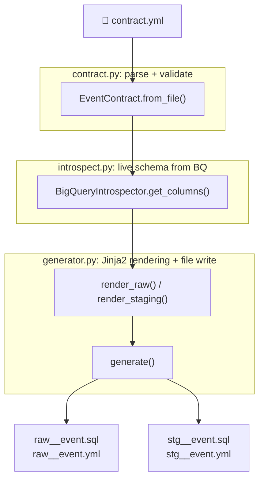
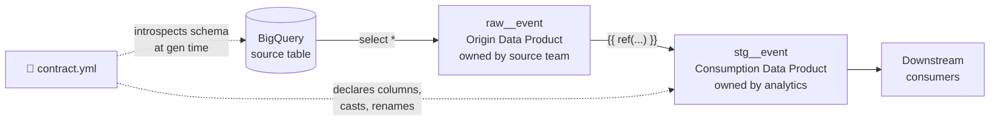
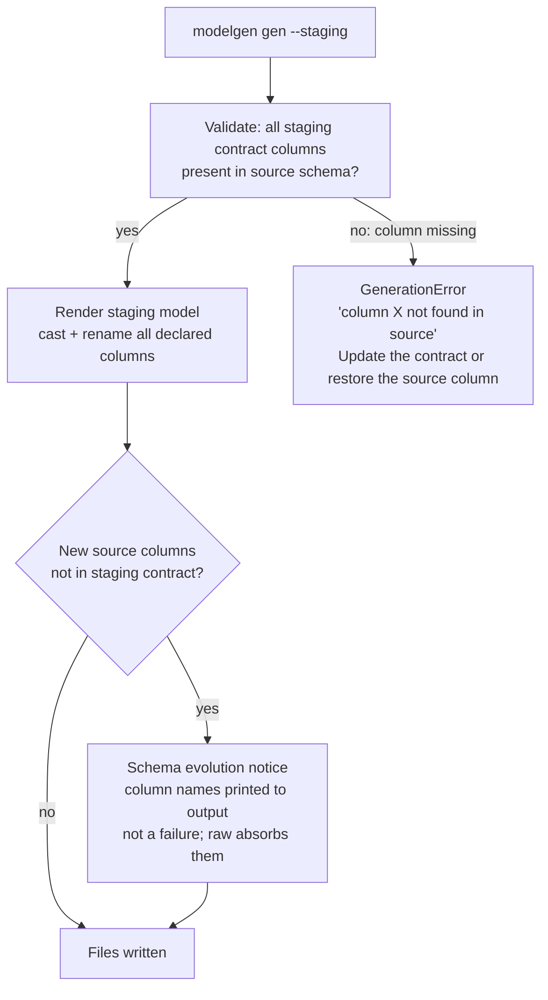

# 👻 Architecture

wraith-modelgen is a pipeline: contract in, dbt models out. Two layers. One direction.

---

## Generation pipeline

---

## Two-layer model

The layers have different owners and different jobs.

**Raw** is a `select *` pass-through. It mirrors the source schema exactly. New source columns flow in automatically. The source team can add columns without coordinating with analytics.

**Staging** is the consumer contract. Explicit column selection, renames, and casts. Schema drift is absorbed here; downstream consumers only see the stable contract names.

---

## Schema evolution

wraith-modelgen surfaces schema changes at generation time, before they affect production.

| Source change | What happens | What you do |
|---|---|---|
| Adds a column | Flows into raw automatically. Invisible in staging. | Add to staging when consumers need it. |
| Renames a column | Validation fails: column not found in source. | Update the `source:` field. Also `unique_key` / `loaded_at_field` if applicable. |
| Retypes a column | Existing `CAST` absorbs it or fails loudly at query time. | Update `type:` if the canonical type changes. |
| Drops a column staging uses | Validation fails: column not found. | Restore upstream or remove from staging contract. |

---

## Module map

| Module | Responsibility |
|---|---|
| `contract.py` | YAML parsing, dataclasses, validation. |
| `introspect.py` | BigQuery schema fetch. `FakeIntrospector` for tests and offline use. |
| `generator.py` | Jinja2 rendering, file writing, schema evolution logic. |
| `cli.py` | Typer commands, Rich output, error handling. |
| `src/templates/` | Jinja2 templates for the four generated artefacts. |

---

## Design decisions

**Deterministic output.** Same contract + same source schema = byte-identical files. CI can diff generated output against committed output to catch contract drift without running a BigQuery query.

**Introspection at gen time, not contract time.** The contract only declares what the consumer cares about. Raw column metadata comes from the live source schema. The warehouse is the source of truth for column names and types; the contract never duplicates them.

**Strict failure on missing columns.** If the contract references a column the source no longer has, generation fails with the column name. A failed build is better than a broken pipeline that nobody noticed.

**BigQuery only, by design.** The introspection module is BQ-native. Generic warehouse support adds complexity for no benefit in this stack. Add a different `Introspector` implementation if you need another warehouse.
