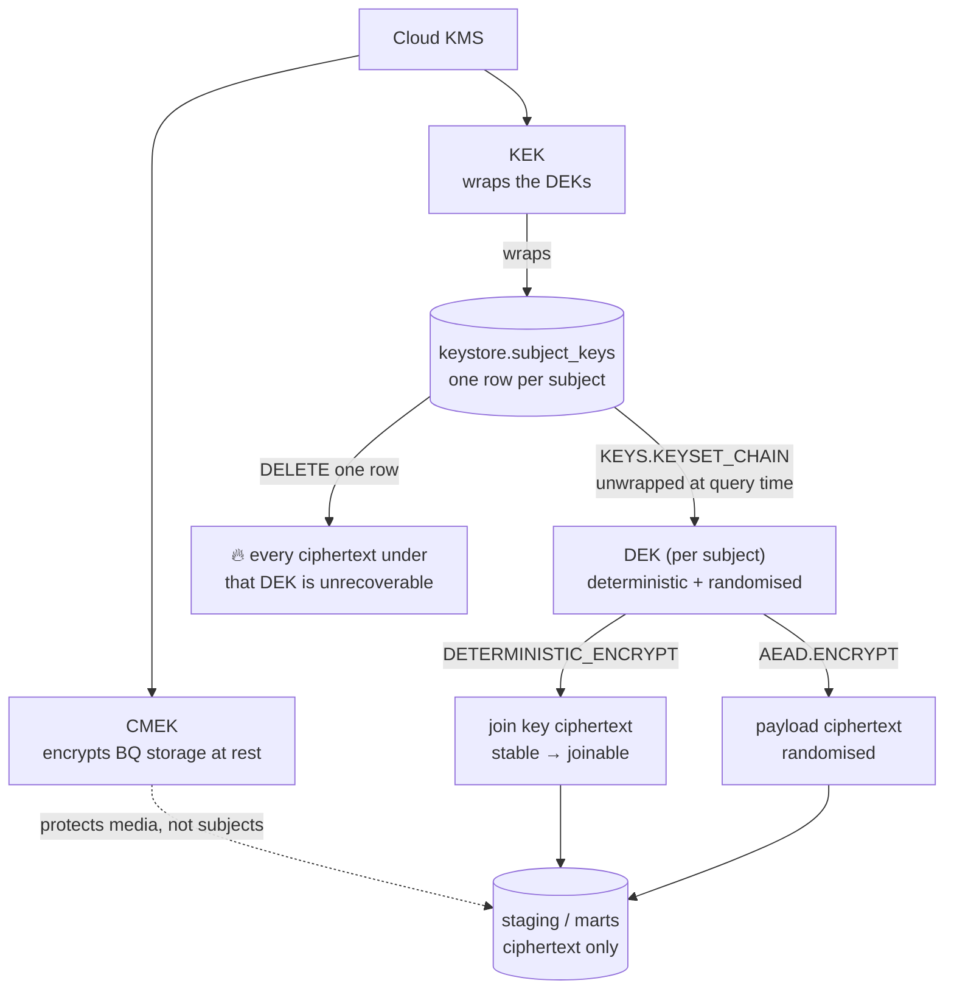

# 👻 Keystore & Crypto-Shred Erasure

**Script:** `models/utils/bq_keystore.sql`

> One row. One delete. Once.

An immutable warehouse and the right to erasure look like a contradiction.
Article 17 says remove the subject; the architecture says never rewrite a
partition. Crypto-shredding resolves it: hold nothing but ciphertext, keep
each subject's key in exactly one mutable row, and erase by destroying the
key rather than the data.

---

## The key hierarchy

Three keys, three jobs. Conflating them is the usual mistake — CMEK is not
an erasure mechanism, and most estates that "have CMEK" have no answer to
Article 17 at all.

| Layer | What it is | Where it lives | Blast radius |
|---|---|---|---|
| **CMEK** | Customer-managed key encrypting BigQuery storage at rest | Cloud KMS, referenced by the dataset | The whole table. Protects the media, not the subject |
| **KEK** | Key encryption key. Wraps each subject's DEKs | Cloud KMS. Never leaves it, never appears in a result | Every subject under that KEK |
| **DEK** | Per-subject data encryption keyset. Encrypts the actual values | The keystore, **wrapped only**. Unwrapped at query time by `KEYS.KEYSET_CHAIN` | One subject |

CMEK and the KEK are both Cloud KMS keys and are easy to confuse. They do
different work: CMEK is a storage property of a dataset, the KEK is an
operand of a query. Rotating CMEK re-encrypts storage and changes nothing
about who can be erased. Deleting a CMEK destroys a whole table, which is
the opposite of a targeted erasure.

The DEK is the only key with a per-subject blast radius, which is why it is
the only one erasure can act on.



## Two DEKs per subject, not one

Tink keysets are primitive-specific, and BigQuery enforces it: a keyset
minted as `DETERMINISTIC_AEAD_AES_SIV_CMAC_256` works with
`DETERMINISTIC_ENCRYPT` and nothing else. One keyset cannot serve both
functions, so each subject gets two.

| DEK | Key type | Encrypts | Why |
|---|---|---|---|
| Deterministic | `DETERMINISTIC_AEAD_AES_SIV_CMAC_256` | The subject-scoped join key | Ciphertext is stable per keyset, so joins, row counts, and aggregates all survive the shred. **This is the property the whole design rests on** |
| Randomised | `AEAD_AES_GCM_256` | Payload | No stable ciphertext to correlate across rows |

Both are wrapped by the same KEK and destroyed by the same delete, so the
erasure story is unaffected: still one row, still one delete.

Deterministic encryption under a shared key would be vulnerable to
frequency analysis on a low-cardinality column — encrypt a boolean and you
have published a boolean. Under **per-subject** keysets the concern is
immaterial: two subjects with the same plaintext produce different
ciphertext. It survives as a lint rule rather than an argument.

## Erasure: what actually happens, and when

`CALL project.keystore.shred_subject('...')` deletes one row. That is the
whole operation. Nothing is rewritten downstream.

Be honest about the timeline, because "irrecoverable" is not instantaneous:

| Window | Duration | Who can recover the DEK |
|---|---|---|
| Time travel | 48h (BigQuery minimum; 168h default) | Anyone with query access, via `FOR SYSTEM_TIME AS OF` |
| Fail-safe | 7 days after time travel | Google Cloud support only |
| After that | — | Nobody |

Worst case with a 48-hour window: roughly **nine days** to genuine
unrecoverability. UK GDPR allows one calendar month from receipt, extendable
by two further months for complex or numerous requests, so nine days closes
comfortably inside the deadline — but it has to be a deliberate setting, not
an accident of the default.

Time travel is a **dataset** property, which is why the keystore gets a
dataset of its own rather than sitting in `utils`. Terraform owns it, per
the standing decision that [Terraform owns datasets](decisions.md):

```sql
ALTER SCHEMA `project.keystore` SET OPTIONS (max_time_travel_hours = 48);
```

!!! danger "Never snapshot the keystore"
    A snapshot is a second copy of the thing whose deletion is the erasure.
    This is not abstract: modelgen's staging layer now defaults to
    [`ds` snapshots](scd2.md). The keystore is not a modelgen model, has no
    contract, and must never acquire one. The same applies to scheduled
    table copies, BigQuery table clones, and exports to GCS.

## Where decryption is allowed

**Ciphertext propagates through every materialised layer.** Decryption
happens in a view, or at query time for an authorised reader. Never into a
table.

This is a correctness constraint, not a performance preference. A table
holding decrypted PII is a second copy the shred never reaches. Erasure then
fails **silently**, with nothing anywhere to surface the failure — no error,
no failed test, no row count that looks wrong. You find out from the
regulator.

Encryption happens on the way into `staging`, the boundary that already owns
casts and renames. `raw` holds source values as received.

```
raw       ← source values as received
staging   ← ciphertext. classification drives which columns
marts     ← ciphertext. still
view      ← decryption, for a reader with both BQ and KMS permission
```

!!! warning "Raw is outside the shred"
    `raw` holds classified values in plaintext by design — it is the record
    of what the source actually sent. The crypto-shred does not reach it.
    Erasure in `raw` is **retention**, not rewriting: give the raw dataset a
    partition expiry short enough that plaintext ages out inside your
    response deadline. modelgen cannot check this for you, which is exactly
    why it is written down here.

An authorised reader needs two grants, not one: BigQuery access to the
table, and `cloudkms.cryptoKeyVersions.useToDecrypt` on the KEK. Splitting
those across roles is the point — a warehouse admin with full BigQuery
access still reads nothing but ciphertext.

## What modelgen generates

Classification rides the contract. A property marked `classification: pii`
or `psi` is encrypted into staging with no further instruction, the same way
`required: true` becomes a `not_null` test:

```yaml
      - property: modelgenSubjectField
        value: USER_ID              # the subject → deterministic

      - name: user_id
        physicalName: USER_ID
        physicalType: STRING
        required: true
        classification: pii
      - name: email
        physicalName: EMAIL
        physicalType: STRING
        classification: psi         # payload → randomised
```

modelgen then emits the keystore join and the encrypt calls into
`stg__<event>.sql`, declares the columns as `BYTES` in the `.yml`, and
carries the classification into column `meta`. Full generated shape in the
[Technical Reference](../reference.md).

Eight lint rules gate the wiring, because encryption is only as good as the
contract configuring it: an unclassified subject column, a subject that is
not a declared property, a classified column used as a cluster or partition
key (BigQuery supports neither on `BYTES`), an enumerated column marked
classified. See [Lint Rules](../linting.md).

## Procedures

| Procedure | What it does |
|---|---|
| `keystore.issue_keyset` | Mints both DEKs for a subject, already wrapped. Idempotent — safe on every ingest |
| `keystore.shred_subject` | The one delete. Idempotent; a second call reports 0 and changes nothing |
| `keystore.verify_shred` | Asserts the keyset is gone. `breach = TRUE` means the shred did not take |

`KEYS.NEW_WRAPPED_KEYSET` mints the keyset already wrapped, so the plaintext
DEK never exists outside BigQuery's execution — there is no step where an
operator handles raw key material.

Encrypt and decrypt query templates live at the bottom of
`models/utils/bq_keystore.sql`.

## What survives the shred, and what does not

This is the part worth understanding before anyone signs off on it.

| After shredding a subject | Result |
|---|---|
| Row counts, `SUM`, `COUNT DISTINCT` over staging | Unchanged. The rows are still there |
| A join between two tables on the encrypted key | Still joins. Deterministic ciphertext is stable |
| Reconstructing a historical regulatory position in aggregate | Works |
| Attributing any row to that individual | Impossible |
| A decrypting view | Their rows drop out; the join finds no keyset |

A historical FinRep or RegRep submission still reconstructs; subject-level
attestation does not. That is precisely the line Article 17 draws.

## Standing caveats

- **Crypto-erase is a position, not a settled fact.** Ciphertext remains on
  disk. NIST classifies Cryptographic Erase as a valid Purge technique and
  it is widely accepted, but whether a given regulator accepts it as
  erasure under Article 17 is a legal judgement your DPO makes, not one this
  document makes for you. Record the position and the reasoning.
- **The keystore is the crown jewel.** It is the one place plaintext subject
  identifiers live. Read access to it is read access to every subject in the
  estate. IAM it accordingly, separately from the warehouse.
- **Backups count as copies.** Any keystore backup, export, or replica
  outside the time-travel window reopens the recovery path the shred is
  meant to close.

## Citations

| Reference | What it supports |
|---|---|
| NIST SP 800-88 Rev. 1, *Guidelines for Media Sanitization* | Defines **Cryptographic Erase (CE)** as a Purge-level sanitization technique — the formal name for what this design does |
| NIST SP 800-57 Part 1 Rev. 5, *Recommendation for Key Management* | KEK / DEK terminology and the key-hierarchy model |
| UK GDPR Article 17 | Right to erasure |
| UK GDPR Article 12(3) | One calendar month to respond, extendable by two further months for complex or numerous requests |
| UK GDPR Article 5(2) | Accountability — why a record of the erasure request is kept even after the subject is erased |
| BigQuery [AEAD encryption functions](https://cloud.google.com/bigquery/docs/reference/standard-sql/aead_encryption_functions) | `AEAD.ENCRYPT`, `DETERMINISTIC_ENCRYPT`, `KEYS.NEW_WRAPPED_KEYSET`, `KEYS.KEYSET_CHAIN` |
| BigQuery [CMEK](https://cloud.google.com/bigquery/docs/customer-managed-encryption) | Dataset-level at-rest encryption, and why it is not the erasure mechanism |
| BigQuery [time travel and fail-safe](https://cloud.google.com/bigquery/docs/time-travel) | The 48h–168h window, and the 7-day fail-safe period after it |

!!! warning "Do not quote 40 days"
    The 40-day limit is DPA 1998 s.7 subject access, long superseded. Under
    UK GDPR it is one calendar month from receipt. Getting this wrong in
    front of a regulator is not a good look.

## Related

- [Tooling Decisions](decisions.md) — the decision record and its reasoning
- [SCD Type 2](scd2.md) — `ds` snapshots, and why the keystore is exempt
- [Architecture](architecture.md) — layer responsibilities
