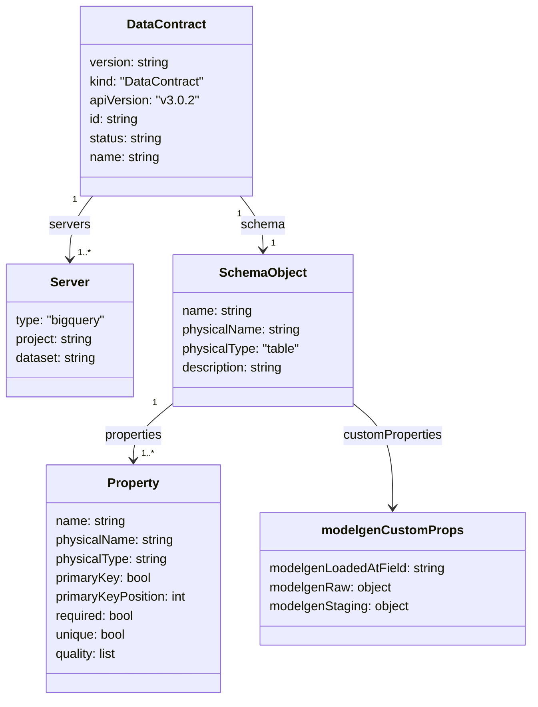

# 👻 Technical Reference

## Contract structure

A contract is an [Open Data Contract Standard (ODCS) v3.0.2](https://github.com/bitol-io/open-data-contract-standard) YAML document, validated against the bundled ODCS JSON schema. It describes exactly **one** table: a BigQuery `server` (source project + dataset), one `schema` object (the source table), and its `properties` (the staging columns). modelgen's BigQuery/dbt specifics live in `customProperties`.



---

## Contract schema

### Top-level (ODCS)

| Field | Type | Required | Description |
|---|---|---|---|
| `version` | string | yes | Contract version (semver) |
| `kind` | string | yes | Must be `DataContract` |
| `apiVersion` | string | yes | ODCS version; modelgen targets `v3.0.2` |
| `id` | string | yes | Unique contract id (e.g. a UUID) |
| `status` | string | yes | e.g. `active`, `draft` |
| `name` | string | no | Data product name |
| `servers` | list | yes | Must include one `type: bigquery` server |
| `schema` | list | yes | Exactly one schema object (the source table) |

### `servers[]` (the `bigquery` entry)

| Field | Required | Description |
|---|---|---|
| `type` | yes | Must be `bigquery` |
| `project` | yes | GCP project ID |
| `dataset` | yes | BigQuery dataset |

### `schema[0]` (the source table)

| Field | Required | Description |
|---|---|---|
| `name` | yes | Entity name → model filenames (`raw__<name>`, `stg__<name>`) |
| `physicalName` | yes | Source table name |
| `physicalType` | no | `table` |
| `description` | no | Human-readable description |
| `properties` | yes | Staging columns (see below) |
| `customProperties` | yes | modelgen dbt/layer config (see below) |

### `schema[0].properties[]` (staging columns)

| Field | Required | Description |
|---|---|---|
| `name` | yes | Column name in staging (consumer-facing) |
| `physicalName` | no | Source column name (defaults to `name`) |
| `physicalType` | no | BigQuery `CAST` target, e.g. `STRING`, `TIMESTAMP`, `INT64` |
| `description` | no | Column description (written to `.yml`) |
| `primaryKey` / `primaryKeyPosition` | no | Marks a `unique_key` column (uses source names, ordered by position) |
| `required` | no | → `not_null` test |
| `unique` | no | → `unique` test |
| `quality` | no | `rule: validValues` + `validValues: [...]` → `accepted_values` test |
| `classification` | no | `pii` or `psi` → the column is **encrypted** into staging and emitted as `BYTES`. See [Keystore & Erasure](bigquery/keystore.md) |

Classification is ODCS's own field, and it drives encryption at generation
time — the same seam that turns `required: true` into a `not_null` test with
no human in the loop. The alternative is what most large estates have: a
classification field in a catalogue that no pipeline reads and no gate
enforces.

modelgen does not use ODCS `encryptedName`. That field assumes a plaintext
column with an encrypted sibling; here the column **is** the ciphertext,
because a plaintext copy is exactly the second copy a crypto-shred can never
reach.

### `schema[0].customProperties` (modelgen config)

| `property` | Value | Description |
|---|---|---|
| `modelgenLoadedAtField` | string | Source timestamp column for incremental filtering |
| `modelgenSubjectField` | string | Source column identifying the data subject. Required once any property is classified. Encrypted deterministically, and the keystore lookup for every other classified column on the row |
| `modelgenRaw` | object | Raw layer config: `dataset`, `incrementalStrategy`, `dedup`, `partitionBy {field, dataType, granularity}`, `clusterBy` |
| `modelgenStaging` | object | Staging layer config: `dataset`, `materialization`, `clusterBy`, plus `generate: false` for a raw-only contract. `dedup` is rejected — it is a raw-layer concern |

`modelgenStaging.materialization` defaults to `snapshot`: a datestamped
daily snapshot, one full copy of the dimension per `ds` partition. It
derives `incrementalStrategy: insert_overwrite` and `partitionBy` on `ds`,
so a snapshot contract states neither. `materialization: incremental`
restores the high-water-mark load, and then `incrementalStrategy` and
`partitionBy` are yours to declare.

---

## Generated files

### `raw__<name>.sql`

```sql
{{ config(
    materialized='incremental',
    unique_key='EVENT_ID',
    incremental_strategy='merge',
    partition_by={...},
    cluster_by=[...]
) }}

with source as (
    select
        EVENT_ID,
        USER_ID,
        RECEIVED_AT
        -- ... all columns introspected at gen time
    from {{ source('landing', 'user_signups_raw') }}
    
        where RECEIVED_AT > (select max(RECEIVED_AT) from {{ this }})
    
),

-- dedup CTE (when dedup: true)
deduplicated as (
    select
        EVENT_ID,
        USER_ID,
        RECEIVED_AT,
        -- ...
        row_number() over (
            partition by EVENT_ID
            order by RECEIVED_AT desc
        ) as _modelgen_rn
    from source
)

select
    EVENT_ID,
    USER_ID,
    RECEIVED_AT
    -- ...
from deduplicated
where _modelgen_rn = 1
```

Raw uses source-side column names throughout. Columns are listed explicitly — introspected from BigQuery (or the contract in `--from-contract` mode) at generation time. Regenerate when the source schema changes.

### `raw__<name>.yml`

dbt `sources` entry (all introspected columns) + model definition.

### `stg__<name>.sql`

Default — `materialization: snapshot`. One full copy of the dimension per
`ds` partition, no high-water mark to filter on:

```sql
{{ config(
    materialized='incremental',
    incremental_strategy='insert_overwrite',
    schema='staging',
    partition_by={'field': 'ds', 'data_type': 'date', 'granularity': 'day'},
    cluster_by=[...]
) }}

with source as (
    select
        EVENT_ID,
        RECEIVED_AT
        -- ... source-side names declared in contract
    from {{ ref('raw__user_signed_up') }}
)

select
    cast(EVENT_ID as STRING) as event_id,
    cast(RECEIVED_AT as TIMESTAMP) as received_at,
    -- ...
    date('{{ var("ds", run_started_at.strftime("%Y-%m-%d")) }}') as ds
from source
```

No `unique_key`: `insert_overwrite` replaces whole partitions and never
reads it. The `ds` stamp defaults to dbt's run date, so a backfill is the
same SQL with `--vars '{ds: YYYY-MM-DD}'`.

With `materialization: incremental` — the high-water-mark load, keyed on
the contract's own `incrementalStrategy` and `partitionBy`:

```sql
{{ config(
    materialized='incremental',
    incremental_strategy='merge',
    unique_key='event_id',
    schema='staging',
    partition_by={...},
    cluster_by=[...]
) }}

with source as (
    select
        EVENT_ID,
        RECEIVED_AT
    from {{ ref('raw__user_signed_up') }}

    
    where RECEIVED_AT > (select max(received_at) from {{ this }})
    
)

select
    cast(EVENT_ID as STRING) as event_id,
    cast(RECEIVED_AT as TIMESTAMP) as received_at
from source
```

Staging uses staging-side names. Raw names never leak downstream.

With classified properties — the keystore is joined and every classified
column is encrypted on the way in:

```sql
with source as (
    select EVENT_ID, USER_ID, COUNTRY_CODE
    from {{ ref('raw__user_signed_up') }}
),

keyed as (

    select
        source.*,
        keystore.kek_resource_name,
        keystore.wrapped_dek_deterministic,
        keystore.wrapped_dek_randomised,
        cast(keystore.subject_id as bytes) as _modelgen_aad
    from source
    left join {{ source('keystore', 'subject_keys') }} as keystore
        on keystore.subject_id = source.USER_ID

)

select
    cast(EVENT_ID as STRING) as event_id,
    deterministic_encrypt(
        keys.keyset_chain(kek_resource_name, wrapped_dek_deterministic),
        cast(USER_ID as STRING),
        _modelgen_aad
    ) as user_id,
    aead.encrypt(
        keys.keyset_chain(kek_resource_name, wrapped_dek_randomised),
        cast(COUNTRY_CODE as STRING),
        _modelgen_aad
    ) as country_code
from keyed
```

The subject column gets `DETERMINISTIC_ENCRYPT` so its ciphertext is stable
per keyset and joins survive a crypto-shred; everything else gets randomised
`AEAD.ENCRYPT`. AAD is bound to the subject, so ciphertext cannot be lifted
into another row. The join is a **`left join`** deliberately: a subject with
no keyset must not silently vanish from staging — the row survives with NULL
ciphertext, which the `not_null` test turns into a visible failure.

`{{ source('keystore', 'subject_keys') }}` is a convention, not a contract
key: one keystore per warehouse, declared as a dbt source. See
[Keystore & Erasure](bigquery/keystore.md).

### `stg__<name>.yml`

dbt model definition with declared columns and their tests. In snapshot mode
it also declares `ds`, and scopes any `unique` test to one partition — the
grain is (key, `ds`), so an unscoped test would fail once a second snapshot
lands.

A classified column is declared as `data_type: BYTES` — whatever its
plaintext type — and carries its classification in `meta` so a downstream
policy-tag applier can find it:

```yaml
      - name: user_id
        data_type: BYTES
        description: "The ID of the user who signed up."
        meta:
          classification: pii
          encrypted: true
        tests:
          - not_null
```

modelgen does not emit BigQuery **policy tags**. They need a taxonomy
resource name that cannot be derived from a contract, and column-level
access control belongs with the rest of IAM — which Terraform owns. The
`meta` block is the machine-readable hook to apply them from.

---

## Type mapping

`IntrospectedColumn.dbt_data_type` maps BigQuery field modes and types to dbt-compatible strings:

| BigQuery mode | BigQuery type | dbt type |
|---|---|---|
| `REPEATED` | any | `ARRAY<type>` |
| any | `RECORD` | `STRUCT` |
| any | everything else | raw BQ type (e.g. `STRING`, `INT64`) |
