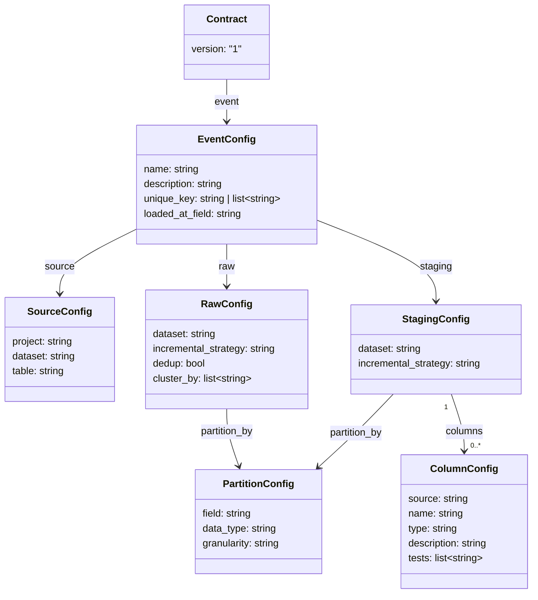

# 👻 Technical Reference

## Contract structure

A contract is a YAML file. It has one event. The event has a source, a raw layer config, and a staging layer config.



---

## Contract schema

### Top-level

| Field | Type | Required | Description |
|---|---|---|---|
| `version` | string | yes | Must be `"1"` |
| `event` | mapping | yes | The event/entity definition |

### `event`

| Field | Type | Required | Description |
|---|---|---|---|
| `name` | string | yes | Event name — used in model filenames (`raw__<name>`, `stg__<name>`) |
| `description` | string | no | Human-readable description |
| `unique_key` | string or list | yes | Source column(s) that uniquely identify a row |
| `loaded_at_field` | string | yes | Source timestamp column used for incremental filtering |
| `source` | mapping | yes | BigQuery source reference |
| `raw` | mapping | no | Raw layer config (defaults apply) |
| `staging` | mapping | yes | Staging layer config |

### `source`

| Field | Required | Description |
|---|---|---|
| `project` | yes | GCP project ID |
| `dataset` | yes | BigQuery dataset |
| `table` | yes | BigQuery table |

### `raw`

| Field | Default | Description |
|---|---|---|
| `dataset` | `raw` | Target dataset |
| `incremental_strategy` | `merge` | dbt incremental strategy |
| `dedup` | `false` | Deduplicate via `row_number()` partitioned by `unique_key` |
| `partition_by` | none | Partition config: `field`, `data_type`, `granularity` |
| `cluster_by` | `[]` | Cluster columns (source-side names) |

### `staging`

| Field | Default | Description |
|---|---|---|
| `dataset` | `staging` | Target dataset |
| `incremental_strategy` | `merge` | dbt incremental strategy |
| `partition_by` | none | Partition config: `field`, `data_type`, `granularity` — uses staging-side names |
| `cluster_by` | `[]` | Cluster columns (staging-side names) |
| `columns` | `[]` | Declared columns (see below). Empty list = raw-only contract. |

### `staging.columns[]`

| Field | Required | Description |
|---|---|---|
| `source` | yes | Column name in raw / source schema |
| `name` | no | Column name in staging (defaults to `source.lower()`) |
| `type` | no | BigQuery type for `CAST` — e.g. `STRING`, `TIMESTAMP`, `INT64` |
| `description` | no | Column description (written to `.yml`) |
| `tests` | no | dbt tests: `not_null`, `unique`, `accepted_values`, etc. |

---

## Generated files

### `raw__<name>.sql`

```sql
{{ config(
    materialized='incremental',
    unique_key='EVENT_ID',
    incremental_strategy='merge',
    partition_by={...},
    cluster_by=[...]
) }}

-- Optional dedup CTE (when dedup: true)
with deduped as (
    select *,
        row_number() over (
            partition by EVENT_ID
            order by RECEIVED_AT desc
        ) as _row_num
    from {{ source('landing', 'user_signups_raw') }}
    
        where RECEIVED_AT > (select max(RECEIVED_AT) from {{ this }})
    
)

select * except (_row_num)
from deduped
where _row_num = 1
```

Raw uses source-side column names throughout. `select *` — whatever the source has, raw has.

### `raw__<name>.yml`

dbt `sources` entry (all introspected columns) + model definition.

### `stg__<name>.sql`

```sql
{{ config(
    materialized='incremental',
    unique_key='event_id',
    incremental_strategy='merge',
    partition_by={...},
    cluster_by=[...]
) }}

with source as (
    select
        cast(EVENT_ID as STRING)   as event_id,
        cast(RECEIVED_AT as TIMESTAMP) as received_at
    from {{ ref('raw__user_signed_up') }}
    
        where RECEIVED_AT > (select max(received_at) from {{ this }})
    
)

select * from source
```

Staging uses staging-side names. Raw names never leak downstream.

### `stg__<name>.yml`

dbt model definition with declared columns and their tests.

---

## Type mapping

`IntrospectedColumn.dbt_data_type` maps BigQuery field modes and types to dbt-compatible strings:

| BigQuery mode | BigQuery type | dbt type |
|---|---|---|
| `REPEATED` | any | `ARRAY<type>` |
| any | `RECORD` | `STRUCT` |
| any | everything else | raw BQ type (e.g. `STRING`, `INT64`) |
