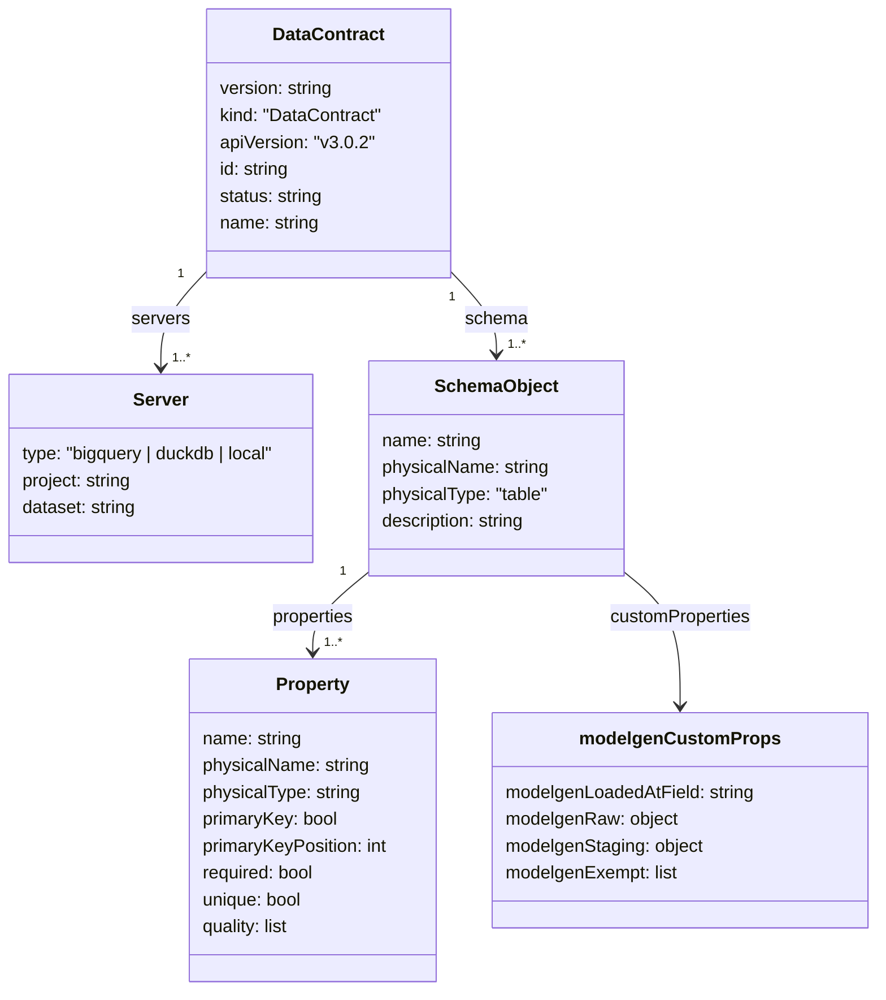

# 👻 Technical Reference

## Contract structure

A contract is an [Open Data Contract Standard (ODCS)](https://github.com/bitol-io/open-data-contract-standard) YAML document (v3.0.2, v3.1.0 or v3.2.0), validated against the bundled ODCS JSON schema for its `apiVersion`. It lists one or more `servers` (BigQuery, DuckDB or `local`, see [Targets and dialects](#targets-and-dialects)) and one or more `schema` objects (the tables). `gen` writes one model per schema object, in contract order. Each object's `properties` are its staging columns. modelgen's BigQuery/dbt specifics live in `customProperties`.



---

## Contract schema

### Top-level (ODCS)

| Field | Type | Required | Description |
|---|---|---|---|
| `version` | string | yes | Contract version (semver) |
| `kind` | string | yes | Must be `DataContract` |
| `apiVersion` | string | yes | ODCS version: `v3.0.2` (default), `v3.1.0` or `v3.2.0`. Picks the bundled JSON schema |
| `id` | string | yes | Unique contract id (e.g. a UUID) |
| `status` | string | yes | e.g. `active`, `draft` |
| `name` | string | no | Data product name |
| `servers` | list | yes | At least one server whose `type` has a dialect: `bigquery`, `duckdb` or `local` |
| `schema` | list | yes | One or more schema objects (tables). Several objects yield several models; narrow with `--table` |

### `servers[]`

| Field | Required | Description |
|---|---|---|
| `server` | yes | Server id, matched by `--server` |
| `type` | yes | `bigquery`, `duckdb` or `local`. Any other type has no dialect and is skipped |

For `bigquery`, add `project` (GCP project ID) and `dataset`. Keys for the other types are in the next section.

### `schema[]` (a source table)

| Field | Required | Description |
|---|---|---|
| `name` | yes | Entity name → model filenames (`raw__<name>`, `stg__<name>`) |
| `physicalName` | yes | Source table name |
| `physicalType` | no | `table` |
| `description` | no | Human-readable description |
| `properties` | yes | Staging columns (see below) |
| `customProperties` | yes | modelgen dbt/layer config (see below) |

### `schema[].properties[]` (staging columns)

| Field | Required | Description |
|---|---|---|
| `name` | yes | Column name in staging (consumer-facing) |
| `physicalName` | no | Source column name (defaults to `name`) |
| `physicalType` | no | BigQuery `CAST` target, e.g. `STRING`, `TIMESTAMP`, `INT64` |
| `description` | no | Column description (written to `.yml`) |
| `primaryKey` / `primaryKeyPosition` | no | Marks a `unique_key` column (uses source names, ordered by position) |
| `required` | no | → `not_null` test |
| `unique` | no | → `unique` test |
| `quality` | no | `rule: validValues` + `validValues: [...]`, or the library form, → `accepted_values` test in every mode. See [Quality-rule mapping](#quality-rule-mapping) |
| `classification` | no | `pii` or `psi` → the column is **encrypted** into staging and emitted as `BYTES`. BigQuery only: DuckDB generation refuses classified columns. See [Keystore & Erasure](bigquery/keystore.md) |
| `customProperties` | no | `modelgenExempt`, lint exemptions scoped to this column only. See [Lint Rules](linting.md#exemptions) |

Classification is ODCS's own field, and it drives encryption at generation
time, the same seam that turns `required: true` into a `not_null` test with
no human in the loop. Declaring it in the contract is what makes it take
effect, rather than recording it in a catalogue that nothing downstream
reads.

modelgen does not use ODCS `encryptedName`. That field assumes a plaintext
column with an encrypted sibling; here the column **is** the ciphertext,
because a plaintext copy is exactly the second copy a crypto-shred can never
reach.

### `schema[].customProperties` (modelgen config)

| `property` | Value | Description |
|---|---|---|
| `modelgenLoadedAtField` | string | Source timestamp column for incremental filtering |
| `modelgenSubjectField` | string | Source column identifying the data subject. Required once any property is classified. Encrypted deterministically, and the keystore lookup for every other classified column on the row |
| `modelgenRaw` | object | Raw layer config: `dataset`, `incrementalStrategy`, `dedup`, `partitionBy {field, dataType, granularity}`, `clusterBy`, `freshness {warnAfter, errorAfter}` |
| `modelgenStaging` | object | Staging layer config: `dataset`, `materialization`, `clusterBy`, plus `generate: false` for a raw-only contract. `dedup` is rejected, because it is a raw-layer concern |
| `modelgenExempt` | list | Lint exemptions, each `{rule, reason}`. Contract-scoped here; a property's own `customProperties` scopes to that column. `reason` is mandatory. See [Lint Rules](linting.md#exemptions) |

`modelgenStaging.materialization` defaults to `snapshot`: a datestamped
daily snapshot, one full copy of the dimension per `ds` partition. It
derives `incrementalStrategy: insert_overwrite` and `partitionBy` on `ds`,
so a snapshot contract states neither. `materialization: incremental`
restores the high-water-mark load, and then `incrementalStrategy` and
`partitionBy` are yours to declare.

`modelgenRaw.freshness` takes `warnAfter` and `errorAfter`, each
`{count: <positive int>, period: minute|hour|day}`. Both are optional
individually, and whatever is given is emitted as the dbt `freshness:` block on
the generated source, ready for `dbt source freshness`. Omitting the block
raises the `missing-freshness` warning. See [Lint Rules](linting.md#source-freshness).

---

## Targets and dialects

A contract picks its dialect from the `type` of each `servers[]` entry. The
dialect decides which keys locate the source and how SQL is rendered.

| `servers[].type` | Dialect | Where the source lives |
|---|---|---|
| `bigquery` | BigQuery | `project` and `dataset` keys on the server |
| `duckdb` | DuckDB | First set of `database`, `path`, `location`, `server`. Schema is the `schema` key, default `main` |
| `local` | DuckDB | Same keys as `duckdb`. With `format: parquet`, the location is a Parquet landing file that dbt-duckdb reads through the source's `external_location` meta |

```yaml
servers:
  - server: prod
    type: bigquery
    project: my-gcp-project
    dataset: landing
  - server: build-warehouse
    type: duckdb
    database: ./dbt/build.duckdb
    schema: main
  - server: extract-local
    type: local
    format: parquet
    path: dbt/data/bus_positions_*.parquet
```

DuckDB limits, enforced by lint or generation:

- Models are views unless the contract says `materialization: table`. Staging
  `incremental` passes lint but renders as a view.
- No partitions or clustering. Declaring `partitionBy` or `clusterBy` is a lint
  error. The derived `ds` partition of a snapshot is the one exception, and
  DuckDB never adds a `ds` column.
- No encryption. Classified columns are pseudonymised instead: the
  `modelgenSubjectField` column is staged as a stable `sha256` hash and every
  other classified column is omitted from staging, so it exists in the raw layer
  only. A classified column in the unique key is a lint error
  (`classified-column-omitted`).

### Choosing a server

`--server ID` (`-s`) matches the `server:` value exactly. It works on `gen`,
`schema`, `validate`, `run` and `check`. `sources` has no such flag, and
`gen --layer sources` exits 2 when given one.

- Unknown ID: error listing the server IDs in the contract.
- Known ID with an unsupported type: error listing the supported types.
- No `--server`: the first `type: bigquery` server wins, even after a DuckDB
  one. Otherwise the first server of a supported type, in contract order.
  Otherwise an error listing `bigquery, duckdb, local`.

Introspection is opt-in and follows the dialect. With `--introspect`, `gen`,
`run` and `check` query BigQuery only when the selected server uses the
BigQuery dialect and Application Default Credentials exist. A DuckDB or local
contract
always uses contract-only introspection, with no "No GCP credentials" notice.
`new` stays BigQuery-only.

---

## Sources layer

`modelgen sources` renders one `_<contract-name>__sources.yml` per extract
contract. The filename uses the contract's `name`, not `dbtSourceName`. The
file holds one `sources:` entry with `loaded_at_field`, `freshness`, a
`tables:` list and a column-set test (by default
`dbt_expectations.expect_table_columns_to_match_set`, so the consuming project
needs the `dbt_expectations` package unless `dbtColumnSetTest` replaces it).
Quality rules that map to singular tests go under `tests/generated/` of the
output directory, or of `tests_output` when set.

| Property | Level | Effect |
|---|---|---|
| `dbtSourceName` | contract | Name of the dbt source. Default: the contract `name`. Single value |
| `dbtColumnSetTest` | contract | Name of the column-set test, replacing the dbt_expectations one. For sources that are bare table functions (e.g. DuckDB `read_parquet(...)`), where that test errors. The macro must take the same `column_list` argument. Single value |
| `loadedAtField` | contract | Written as `loaded_at_field`, passed through as written (include any quotes) |
| `freshnessWarnAfter` | contract | `freshness.warn_after`. Format `N minutes`, `N hours` or `N days` |
| `freshnessErrorAfter` | contract | `freshness.error_after`. Same format |
| `externalLocation` | schema object | `meta.external_location` on that table. Wins over the contract-level value |
| `externalLocation` | contract | Used for the table when the contract has exactly one object. With more objects it is a contract error, so set it per object |

The freshness format is one whole number above zero, at least one space, then
`minute(s)`, `hour(s)` or `day(s)`, any case. `2 days` is valid; `2days` and
`0 days` are errors that name the property. A freshness block is written only
when at least one bound is set.

```yaml
customProperties:
  - property: dbtSourceName
    value: bods
  - property: dbtColumnSetTest
    value: columns_match_set
  - property: externalLocation
    value: "read_parquet('data/bus_positions_*.parquet', union_by_name=true)"
  - property: loadedAtField
    value: '"timestamp"'
  - property: freshnessWarnAfter
    value: 2 days
```

```bash
modelgen sources contracts/extract/bus-positions-extract.odcs.yaml -o models/staging
# models/staging/_wraith_bus_extract_positions__sources.yml written
```

Keep extract contracts out of the `contracts` glob in `.modelgen.yml`: event
contracts require `modelgenLoadedAtField`, extract contracts do not carry it.

---

## Quality-rule mapping

Quality rules map per layer.

- Every mode maps `validValues` to `accepted_values`, in either form: the
  property form (`rule: validValues`, `validValues: [...]`) or the ODCS
  library form (`type: library`, `metric: invalidValues`,
  `arguments.validValues`, `mustBe: 0`). Both forms on one column yield one
  test. The property form is valid ODCS only under `apiVersion: v3.0.2`,
  which also needs a `rule` key on a library-form rule.
- `schema` and `sources` (and `gen --layer schema|sources`) also map zero
  `nullValues` and `duplicateValues` to `not_null` and `unique`, and
  `rowCount` with a bound to a row-count test. Other thresholds and
  `type: sql` rules become singular tests under `tests/generated/`.
  Anything unmapped is reported on stderr, never dropped, and `--strict`
  exits 3 for it.
- `gen --staging` maps only `validValues` and reports nothing it skips.
  `gen --raw` emits no quality tests.

Staging renders `accepted_values` with no `where`; `schema` and `sources`
add `where: <column> is not null` on a column that is neither required nor
a primary key. The difference is deliberate.

Generated quality tests call `dbt_expectations.*` macros. `run` and `check`
warn once when the rendered output calls one and the dbt project does not
install the package. They look for `dbt_project.yml` from each output
directory up to the directory holding `.modelgen.yml`, never above it. The
package counts as installed when `packages.yml` or `dependencies.yml` beside
it contains `dbt_expectations` (any publisher, a fork too) or
`dbt_packages/dbt_expectations` exists. The match is a substring, so a
commented-out entry counts. No `dbt_project.yml` found means no warning.
The warning does not change the exit code. `gen`, `schema` and `sources` do
not check.

---

## Generated files

**For `--layer schema` and `--layer sources`:** a single yml per contract
(`_<name>__models.yml`, `_<name>__sources.yml`) plus any singular tests under
`tests/generated/`. Neither writes model SQL.

Every generated file starts with a header, `-- GENERATED by modelgen <version>
from <name> <ver>. Do not edit.` (`#` in yml). The version is read from
installed package metadata, so `check` drifts on every file after a modelgen
upgrade, and output from an uninstalled tree carries `0.0.0`.

### `raw__<name>.sql`

```sql
{{ config(
    materialized='incremental',
    unique_key='EVENT_ID',
    incremental_strategy='merge',
    partition_by={...},
    cluster_by=[...]
) }}

with source as (
    select
        EVENT_ID,
        USER_ID,
        RECEIVED_AT
        -- ... all columns introspected at gen time
    from {{ source('landing', 'user_signups_raw') }}
    
        where RECEIVED_AT > (select max(RECEIVED_AT) from {{ this }})
    
),

-- dedup CTE (when dedup: true)
deduplicated as (
    select
        EVENT_ID,
        USER_ID,
        RECEIVED_AT,
        -- ...
        row_number() over (
            partition by EVENT_ID
            order by RECEIVED_AT desc
        ) as _modelgen_rn
    from source
)

select
    EVENT_ID,
    USER_ID,
    RECEIVED_AT
    -- ...
from deduplicated
where _modelgen_rn = 1
```

Raw uses source-side column names throughout. Columns are listed explicitly, introspected from BigQuery (or from the contract under contract-only introspection) at generation time. Regenerate when the source schema changes.

### `raw__<name>.yml`

dbt `sources` entry (all introspected columns) + model definition.

### `stg__<name>.sql`

Default, `materialization: snapshot`. One full copy of the dimension per
`ds` partition, no high-water mark to filter on:

```sql
{{ config(
    materialized='incremental',
    incremental_strategy='insert_overwrite',
    schema='staging',
    partition_by={'field': 'ds', 'data_type': 'date', 'granularity': 'day'},
    cluster_by=[...]
) }}

with source as (
    select
        EVENT_ID,
        RECEIVED_AT
        -- ... source-side names declared in contract
    from {{ ref('raw__user_signed_up') }}
)

select
    cast(EVENT_ID as STRING) as event_id,
    cast(RECEIVED_AT as TIMESTAMP) as received_at,
    -- ...
    date('{{ var("ds", run_started_at.strftime("%Y-%m-%d")) }}') as ds
from source
```

No `unique_key`: `insert_overwrite` replaces whole partitions and never
reads it. The `ds` stamp defaults to dbt's run date, so a backfill is the
same SQL with `--vars '{ds: YYYY-MM-DD}'`.

With `materialization: incremental`, the high-water-mark load, keyed on
the contract's own `incrementalStrategy` and `partitionBy`:

```sql
{{ config(
    materialized='incremental',
    incremental_strategy='merge',
    unique_key='event_id',
    schema='staging',
    partition_by={...},
    cluster_by=[...]
) }}

with source as (
    select
        EVENT_ID,
        RECEIVED_AT
    from {{ ref('raw__user_signed_up') }}

    
    where RECEIVED_AT > (select max(received_at) from {{ this }})
    
)

select
    cast(EVENT_ID as STRING) as event_id,
    cast(RECEIVED_AT as TIMESTAMP) as received_at
from source
```

Staging uses staging-side names. Raw names never leak downstream.

With classified properties, the keystore is joined and every classified
column is encrypted on the way in:

```sql
with source as (
    select EVENT_ID, USER_ID, COUNTRY_CODE
    from {{ ref('raw__user_signed_up') }}
),

keyed as (

    select
        source.*,
        keystore.kek_resource_name,
        keystore.wrapped_dek_deterministic,
        keystore.wrapped_dek_randomised,
        cast(keystore.subject_id as bytes) as _modelgen_aad
    from source
    left join {{ source('keystore', 'subject_keys') }} as keystore
        on keystore.subject_id = source.USER_ID

)

select
    cast(EVENT_ID as STRING) as event_id,
    deterministic_encrypt(
        keys.keyset_chain(kek_resource_name, wrapped_dek_deterministic),
        cast(USER_ID as STRING),
        _modelgen_aad
    ) as user_id,
    aead.encrypt(
        keys.keyset_chain(kek_resource_name, wrapped_dek_randomised),
        cast(COUNTRY_CODE as STRING),
        _modelgen_aad
    ) as country_code
from keyed
```

The subject column gets `DETERMINISTIC_ENCRYPT` so its ciphertext is stable
per keyset and joins survive a crypto-shred; everything else gets randomised
`AEAD.ENCRYPT`. AAD is bound to the subject, so ciphertext cannot be lifted
into another row. The join is a **`left join`** deliberately: a subject with
no keyset must not silently vanish from staging. The row survives with NULL
ciphertext, which the `not_null` test turns into a visible failure.

`{{ source('keystore', 'subject_keys') }}` is a convention, not a contract
key: one keystore per warehouse, declared as a dbt source. See
[Keystore & Erasure](bigquery/keystore.md).

### `stg__<name>.yml`

dbt model definition with declared columns and their tests. In snapshot mode
it also declares `ds`, and scopes any `unique` test to one partition, since the
grain is (key, `ds`), so an unscoped test would fail once a second snapshot
lands.

A classified column is declared as `data_type: BYTES`, whatever its
plaintext type, and carries its classification in `meta` so a downstream
policy-tag applier can find it:

```yaml
      - name: user_id
        data_type: BYTES
        description: "The ID of the user who signed up."
        meta:
          classification: pii
          encrypted: true
        tests:
          - not_null
```

modelgen does not emit BigQuery **policy tags**. They need a taxonomy
resource name that cannot be derived from a contract, and column-level
access control belongs with the rest of IAM, which Terraform owns. The
`meta` block is the machine-readable hook to apply them from.

---

## Type mapping

`IntrospectedColumn.dbt_data_type` maps BigQuery field modes and types to dbt-compatible strings:

| BigQuery mode | BigQuery type | dbt type |
|---|---|---|
| `REPEATED` | any | `ARRAY<type>` |
| any | `RECORD` | `STRUCT` |
| any | everything else | raw BQ type (e.g. `STRING`, `INT64`) |
