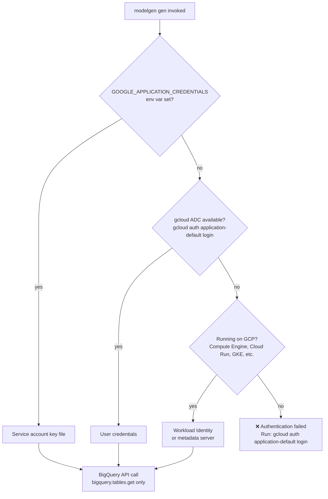
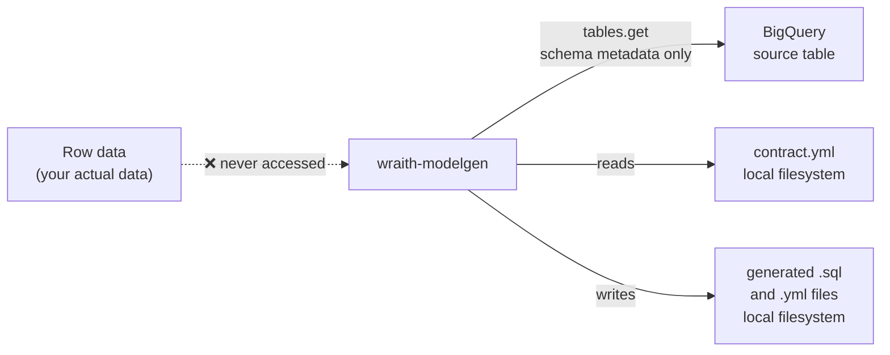

# 👻 Security Statement

wraith-modelgen reads schema metadata. It does not read your data.

---

## Credential resolution

wraith-modelgen uses Google Application Default Credentials (ADC). It never stores, logs, or transmits credentials.

The minimum permission required: **`bigquery.tables.get`** on the source table. Nothing else.

---

## What wraith-modelgen reads

Only schema metadata: column names, types, and modes. No row data, ever.

---

## Contract files

Contract YAML files contain GCP project IDs, dataset names, and table names. Version-control them like any infrastructure config, but keep credentials out of them.

The pre-commit configuration includes `detect-secrets` to block accidental credential commits. If it flags a false positive, update `.secrets.baseline` rather than disabling the hook.

---

---

## Data in the warehouse

This page covers the tool. Protecting the data it generates models for is a
warehouse concern: see [Keystore & Erasure](bigquery/keystore.md) for the
CMEK / KEK / DEK hierarchy and how right-to-erasure is served by
crypto-shredding a single keystore row.

---

## Reporting vulnerabilities

Found something? Report it privately via the [Gitea security advisory](https://git.thomaspeoples.com/thomaspeoples/wraith-modelgen/issues) or email `hello@thomaspeoples.com`. Please don't open a public issue for a security vulnerability.
