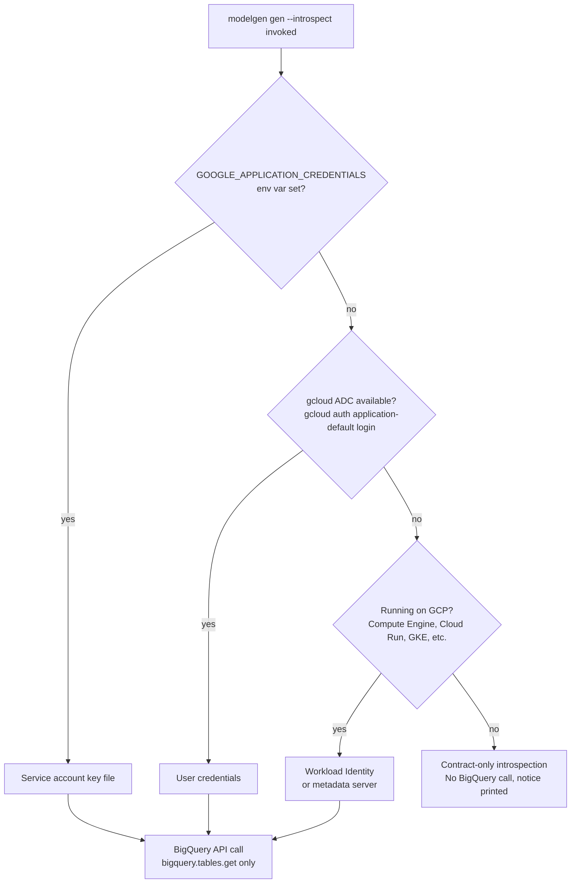
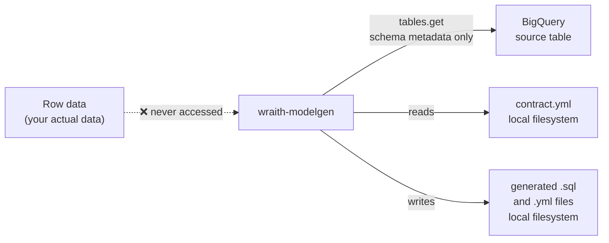

# 👻 Security Statement

wraith-modelgen reads schema metadata. It does not read your data.

---

## Credential resolution

wraith-modelgen makes no network call unless `--introspect` is passed (or `modelgen new` is run). It then uses Google Application Default Credentials (ADC). It never stores, logs, or transmits credentials.

The minimum permission required: **`bigquery.tables.get`** on the source table. Nothing else.

---

## What wraith-modelgen reads

Only schema metadata: column names, types, modes and descriptions. No row data, ever.

The table to read is named by the contract, and the call uses the identity the machine holds. Pass `--introspect` only for contracts you trust.

---

## Contract files

Contract YAML files contain GCP project IDs, dataset names, and table names. Version-control them like any infrastructure config, but keep credentials out of them.

The pre-commit configuration includes `detect-secrets` to block accidental credential commits. If it flags a false positive, update `.secrets.baseline` rather than disabling the hook.

---

## Contracts as input

A contract may be written by another team, and dbt later runs the generated files with warehouse credentials. modelgen therefore refuses a contract that:

- contains Jinja delimiters (`{{`, `{%`, `{#`) in any value, because dbt renders them wherever they appear in a generated file;
- has a `name` or `version` that spans more than one line;
- names a schema object or dbt source with characters outside letters, digits, `_`, `.` and `-` (produced and extract contracts; event contracts have the stricter lint rule);
- is larger than 1 MB, nests more than 64 levels deep, or expands through YAML aliases to more than a million nodes.

Column descriptions, from the contract or from BigQuery, are written as quoted YAML strings and cannot add keys to a generated file. Every generated file is written inside the output directory; a destination that is a symlink or resolves elsewhere is refused.

One thing a contract can still do by design: a `type: sql` quality rule is copied into a dbt test. Review produced and extract contracts as you would review code.

---

---

## Data in the warehouse

This page covers the tool. Protecting the data it generates models for is a
warehouse concern: see [Keystore & Erasure](bigquery/keystore.md) for the
CMEK / KEK / DEK hierarchy and how right-to-erasure is served by
crypto-shredding a single keystore row.

---

## Reporting vulnerabilities

Found something? Report it privately via the [Gitea security advisory](https://git.thomaspeoples.com/thomaspeoples/wraith-modelgen/issues) or email `hello@thomaspeoples.com`. Please don't open a public issue for a security vulnerability.
