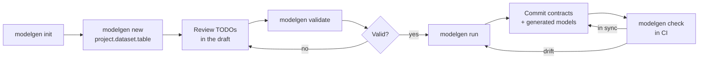

# 👻 Usage

## Lifecycle

Initialise once. Draft contracts from live tables. Generate. Let CI
prove nothing drifted.



```bash
modelgen init                                  # once per repo
modelgen new my-project.landing.user_signups   # draft a contract
modelgen validate contracts/user_signups.yml   # lint it
modelgen run                                   # generate both layers
modelgen check                                 # CI: prove nothing drifted
```

---

## Commands

### `modelgen init`

Scaffold a modelgen project: a documented `.modelgen.yml` plus
`contracts/` and `models/` directories. Refuses to touch a repo that
already has a `.modelgen.yml`.

```bash
modelgen init [DIRECTORY]
```

---

### `modelgen new`

Bootstrap a draft contract from a live BigQuery table. Requires GCP
Application Default Credentials.

```bash
modelgen new PROJECT.DATASET.TABLE [OPTIONS]
```

| Option | Description |
|---|---|
| `-n`, `--name` | Event name (default: derived from the table name) |
| `-o`, `--output PATH` | Directory for the contract (default: `./contracts`) |
| `--force` | Overwrite an existing contract file |

The draft is an ODCS v3.0.2 document. It declares **every** source column
as a schema property with introspected types and descriptions, guesses the
`primaryKey` (column names ending in `id`/`key`/`guid`/`uuid`) and
`modelgenLoadedAtField` (temporal columns named like
`received`/`loaded`/`created`/`*_at`), derives partition config from the
loaded-at column, and pre-wires `required: true` + `unique: true`
(→ `not_null`/`unique`) on the key. Guesses are flagged in the leading
`# TODO` comment — review them before the contract goes live. `RECORD` and
`REPEATED` columns are declared without a cast (`physicalType` omitted).

---

### `modelgen validate`

Offline validation: YAML structure first, then a full semantic lint.
No BigQuery credentials or network access needed.

```bash
modelgen validate contract.yml [--strict]
```

All findings are reported in one pass — typo'd incremental strategies,
casts to types BigQuery has never heard of, duplicate columns, unsafe
identifiers, partition or cluster references to undeclared staging
columns, and keys the staging model never selects. See the
[lint rule catalogue](linting.md).

`--strict` turns warnings (missing descriptions, untested keys) into
failures. For CI gates with standards.

---

### `modelgen gen`

Generate a single layer from a contract. Specify one of `--raw` or `--staging`.

```bash
modelgen gen CONTRACT [OPTIONS]
```

| Option | Description |
|---|---|
| `--raw` | Generate the raw (Origin Data Product) layer |
| `--staging` | Generate the staging (Consumption Data Product) layer |
| `-o`, `--output PATH` | Write files here (default: `./models`) |
| `--dry-run` | Preview without writing |
| `-v`, `--verbose` | Debug logging |
| `--from-contract` | Skip BigQuery introspection (see below) |

Exactly one of `--raw` or `--staging` is required. Contracts with lint
errors are refused before any generation happens.

**Examples:**

```bash
# Generate the raw layer
modelgen gen contract.yml --raw -o ./models/raw

# Generate the staging layer
modelgen gen contract.yml --staging -o ./models/staging

# Preview what would be written
modelgen gen contract.yml --raw --dry-run

# Offline — no BigQuery connection needed
modelgen gen contract.yml --raw --from-contract
```

---

### `modelgen run`

Find all contracts and regenerate every layer in one command.

```bash
modelgen run [OPTIONS]
```

| Option | Description |
|---|---|
| `-c`, `--config PATH` | Path to `.modelgen.yml`. Auto-discovered upward from cwd if not given. |
| `--dry-run` | Preview without writing |
| `-v`, `--verbose` | Debug logging |
| `--from-contract` | Skip BigQuery introspection for all contracts (see below) |

**`.modelgen.yml` config:**

```yaml
contracts: contracts/*.yml    # glob relative to this file's directory
raw_output: models/raw
staging_output: models/staging
```

If `.modelgen.yml` is not found, those values are also the defaults.

Staging generation is skipped for contracts with no columns declared;
raw-only contracts are supported. Each source table is introspected
once per run, even when both layers use it.

---

### `modelgen check`

Drift detection. Renders every contract in memory and compares the
output against the files on disk. **Nothing is written.**

```bash
modelgen check [OPTIONS]
```

| Option | Description |
|---|---|
| `-c`, `--config PATH` | Path to `.modelgen.yml`. Auto-discovered if not given. |
| `--diff` | Print a unified diff for every drifted file |
| `-v`, `--verbose` | Debug logging |
| `--from-contract` | Skip BigQuery introspection for all contracts |

Because generation is deterministic — same contract, same source
schema, byte-identical output — `check` turns that guarantee into a CI
gate. Hand-edited models, stale regenerations, and contract changes
that never got committed all fail loudly:

```yaml
# Gitea Actions / GitHub Actions step
- name: Verify generated models match contracts
  run: |
    uv tool install wraith-modelgen
    modelgen check --diff --from-contract
```

---

## Exit codes

Every command follows the same convention:

| Code | Meaning |
|---|---|
| `0` | Success — or, for `check`, everything in sync |
| `1` | Contract, generation, introspection, or drift failure |
| `2` | Usage error (bad flags, malformed table reference) |

---

## Offline / contract-only mode

By default, `gen`, `run`, and `check` introspect BigQuery at generation
time to validate column references and populate the raw schema YAML. If
no GCP Application Default Credentials are available, they fall back to
**contract-only mode** automatically — no BigQuery connection is made.

You can also force contract-only mode explicitly with `--from-contract`:

```bash
modelgen gen contract.yml --raw --from-contract
modelgen run --from-contract
modelgen check --from-contract
```

**What changes in contract-only mode:**

| Behaviour | With BQ | `--from-contract` |
|---|---|---|
| Column list in `raw_schema.yml` | Full source schema | Contract staging columns + key fields only |
| Schema drift detection | Yes — fails if staging refs missing column | Skipped |
| New source column notices | Yes | Not reported (source not queried) |
| BQ credentials required | Yes | No |

Contract-only mode is useful for local development without a service
account, CI pipelines without GCP access, and bootstrapping a new
contract before the source table exists. `modelgen new` is the one
command that always needs credentials — it has nothing to work from
but the live table.

---

## Contract file

A fully-annotated example: [`contracts/example_contract.yml`](https://git.thomaspeoples.com/thomaspeoples/wraith-modelgen/src/branch/main/contracts/example_contract.yml).

---

## Running the generated staging model

Staging defaults to a datestamped daily snapshot, partitioned on a
generated `ds` column. The daily run needs nothing:

```bash
dbt run --select stg__user_signed_up
```

Backfilling a past date uses the same SQL — pass the date instead of
letting it default to dbt's run date. Dates are independent, so run as
many in parallel as your warehouse will take:

```bash
dbt run --select stg__user_signed_up --vars '{ds: 2026-07-27}'
```

Set `materialization: incremental` on `modelgenStaging` to opt back into a
high-water-mark load. See [Lint Rules](linting.md) for the checks that keep
the two modes from being half-declared.

If the contract classifies any property, the generated model joins the
keystore, so the run needs a dbt source named `keystore.subject_keys` and
the reader needs `cloudkms.cryptoKeyVersions.useToDecrypt` on the KEK. See
[Keystore & Erasure](bigquery/keystore.md).

---

## Schema evolution

Source schemas change. wraith-modelgen validates the boundary and reports what broke.

| Scenario | Behaviour |
|---|---|
| New column added to source | Does **not** appear until you regenerate. Run `modelgen run` (or `modelgen gen --raw`) to pick it up. Invisible in staging until added to the contract. |
| Source column renamed | Update the property's `physicalName` (the `primaryKey` property too, if applicable). The staging `name` stays stable downstream. |
| Source column retyped | Update staging `type:`. The `CAST` absorbs it. If values are incompatible, BigQuery will fail at query time. |
| Source column dropped | Generation fails if staging still references it. Update the contract or restore the source column. |

!!! tip "The layering principle"
    Raw absorbs source drift on each regeneration — columns are explicit, introspected at gen time. Staging absorbs raw drift. Downstream consumers see a stable interface.
