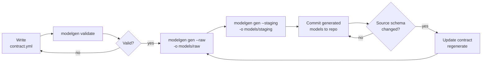

# 👻 Usage

## Workflow

Write a contract. Validate it. Generate. Commit. Repeat when the source changes.



Or, if you've set up `.modelgen.yml`, skip the per-layer invocations entirely:

```bash
modelgen run
```

---

## Commands

### `modelgen validate`

Offline contract validation. No BigQuery credentials, no network, no excuses.

```bash
modelgen validate contract.yml
```

Fix the contract before it costs you a BigQuery introspection call.

---

### `modelgen gen`

Generate a single layer from a contract. Pick one.

```bash
modelgen gen CONTRACT [OPTIONS]
```

| Option | Description |
|---|---|
| `--raw` | Generate the raw (Origin Data Product) layer |
| `--staging` | Generate the staging (Consumption Data Product) layer |
| `-o`, `--output PATH` | Write files here (default: `./models`) |
| `--dry-run` | Preview without writing |
| `-v`, `--verbose` | Debug logging |

Exactly one of `--raw` or `--staging`. Not both. Not neither.

**Examples:**

```bash
# Generate the raw layer
modelgen gen contract.yml --raw -o ./models/raw

# Generate the staging layer
modelgen gen contract.yml --staging -o ./models/staging

# Preview what would be written
modelgen gen contract.yml --raw --dry-run

# Noisy mode
modelgen gen contract.yml --staging --verbose
```

---

### `modelgen run`

Sweep the whole repo. Find every contract. Generate every layer. Do it in one command.

```bash
modelgen run [OPTIONS]
```

| Option | Description |
|---|---|
| `-c`, `--config PATH` | Path to `.modelgen.yml`. Auto-discovered upward from cwd if not given. |
| `--dry-run` | Preview without writing |
| `-v`, `--verbose` | Debug logging |

**`.modelgen.yml` config:**

```yaml
contracts: contracts/*.yml    # glob relative to this file's directory
raw_output: models/raw
staging_output: models/staging
```

If `.modelgen.yml` doesn't exist, opinionated defaults apply:

| Setting | Default |
|---|---|
| `contracts` | `contracts/*.yml` |
| `raw_output` | `models/raw` |
| `staging_output` | `models/staging` |

Staging generation is skipped for any contract that declares zero staging columns — raw-only contracts are a valid use case.

**Example:**

```bash
# Generate everything
modelgen run

# With explicit config
modelgen run --config path/to/.modelgen.yml

# See what would happen
modelgen run --dry-run
```

---

## Contract file

A fully-annotated example: [`example_contract.yml`](https://git.thomaspeoples.com/thomaspeoples/wraith-modelgen/src/branch/main/example_contract.yml).

---

## Schema evolution

Source schemas change. That's their job. wraith-modelgen's job is making sure that's not your problem.

| Scenario | Behaviour |
|---|---|
| New column added to source | Flows through raw automatically (`select *`). Invisible in staging until you add it to the contract. |
| Source column renamed | Validation fails: column not found in source. Update `unique_key` (if applicable) and the staging `source:` field. Staging name stays stable downstream. |
| Source column retyped | Update staging `type:`. The `CAST` absorbs it. If values are incompatible, BigQuery will tell you at query time — not silently. |
| Source column dropped | Generation fails loudly if staging still references it. Fix the contract or fix the source. |

!!! tip "The golden rule"
    Raw absorbs source drift. Staging absorbs raw drift. Downstream consumers are insulated from both.
