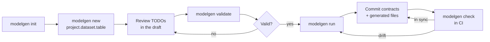

# 👻 Usage

## Lifecycle

Initialise once. Draft contracts from live tables. Generate. Let CI
prove nothing drifted.



```bash
modelgen init                                              # once per repo
modelgen new my-project.landing.user_signups               # draft a contract
modelgen validate contracts/user_signups.yml               # lint it
modelgen run                                               # raw + staging, plus yml for configured produced/extract contracts
modelgen schema contracts/marts.odcs.yaml -o models/marts  # models yml for tables this project produces
modelgen sources contracts/extract.odcs.yaml -o models/staging  # sources yml for tables this project reads
modelgen check --diff                                      # CI: prove nothing drifted
```

`run` renders all three modes. With `schema_contracts`/`schema_output` and/or
`sources_contracts`/`sources_output` set in `.modelgen.yml`, it also writes the
produced and extract yml and their singular tests (honouring `tests_output`),
so `run` then `check` is a clean round trip. The separate `schema` and
`sources` commands stay valid and are no longer required when the keys are set.

---

## Exit codes

| Code | Name | Meaning |
|---|---|---|
| `0` | OK | Success. For `check`, everything in sync. Also when no contracts are found. |
| `1` | INVALID | A contract or `.modelgen.yml` is invalid: YAML or ODCS schema errors, an unsupported `apiVersion`, rejected input, a contract that does not match its source, or a config pattern that matches nothing. |
| `2` | USAGE | Bad or conflicting flags, a path that does not exist, or an action refused until you pass a flag such as `--force`. |
| `3` | LINT | Lint errors, or `--strict` with unmapped quality rules. |
| `4` | DRIFT | `check` found generated files missing or out of sync. |
| `5` | ENVIRONMENT | Credentials or warehouse failure: no GCP credentials where they are required, or introspection failed. |
| `6` | INTERNAL | An unexpected error: a modelgen bug. |

When one run hits more than one of these, it exits with the first that
applies in this order: INTERNAL, ENVIRONMENT, INVALID, LINT, DRIFT.

These codes are stable: a release will not change their meaning.

---

## Machine-readable output

stdout carries results only: tables, summaries, created paths, diffs and,
with `--format json`, the report. stderr carries diagnostics: contract and
config errors, lint findings, notices and warnings. This holds in both
modes, so `modelgen validate contract.yml 2>/dev/null` prints only the
summary of a contract that passed. This includes `run` and `check`:
their tables, summaries and diffs go to stdout, their errors and notices
(`Config error`, `Drift detected`, the no-credentials notice) to stderr.

`--format json` (default `text`, case-insensitive) makes a command print
exactly one JSON document on stdout, with no panels or tables. Six
commands take it: `validate`, `gen`, `schema`, `sources`, `run` and `check`.
`check --diff` is ignored with `--format json`: the document already
carries each file's `sha256` and `on_disk_sha256`.

```bash
modelgen validate contract.yml --format json
```

The document is described by the JSON Schema
[`modelgen-report-v1.json`](https://git.thomaspeoples.com/thomaspeoples/wraith-modelgen/src/branch/main/src/modelgen/schema/modelgen-report-v1.json)
(draft 2020-12), which also ships in the package at
`modelgen/schema/modelgen-report-v1.json`.

| Field | Meaning |
|---|---|
| `schema_version` | `1`. Bumped only when the document changes incompatibly. |
| `tool`, `tool_version` | `"modelgen"` and the installed version. |
| `command` | The command that ran, e.g. `"validate"`. |
| `exit_code` | The process exit status (see [Exit codes](#exit-codes)). |
| `ok` | `true` when `exit_code` is `0`. |
| `inputs` | One entry per contract read: `path` as given and the `sha256` of the file's bytes. |
| `issues` | Every problem found, see below. For a contract that passes, the lint warnings and exempted findings. |
| `files` | Generated files: `path`, `layer`, `sha256` of the generated content, `status` (`written`, `dry_run`, `in_sync`, `drift` or `missing`) and `on_disk_sha256` (`null` when not compared). Empty for `validate`. |

Each issue has:

| Field | Meaning |
|---|---|
| `source` | The contract path. For a malformed `.modelgen.yml`, the config path. For `dbt-package-missing`, the `dbt_project.yml` path. |
| `object` | The schema object (event) name when known, else `null`. For `quality-rule-unmapped` it is the rule, as `<model>.<rule>`. |
| `code` | A lint rule code (see [linting](linting.md)), or one of: `schema.<keyword>`, `yaml`, `limit`, `odcs-version` or `contract` (a contract or `.modelgen.yml` that could not be read); `odcs-version-deprecated` (a warning, see [compatibility](compatibility.md)); `quality-rule-unmapped` (a quality rule with no dbt test; an error under `--strict`); `generation` (a model could not be generated); `introspection` (a source table could not be introspected); `internal` (an unexpected error, exit `6`); `dbt-package-missing` (a warning from `run` and `check`: the dbt project does not install `dbt_expectations`, which the generated tests call). |
| `severity` | `error` or `warning`. |
| `message` | The human-readable message. |
| `pointer` | JSON pointer into the contract (`""` is the document root), or `null`. |
| `line`, `column` | 1-based position in the file, or `null`. |
| `exempt_reason` | The `modelgenExempt` reason for an exempted finding, else `null`. |

A contract that fails the ODCS schema exits `1` with one issue per schema
error; lint errors exit `3` with one issue per finding.

Usage errors (exit `2`) are the exception: bad or unknown flags are
rejected while the command line is parsed, before any command runs, so
they print text on stderr and no document.

---

## Commands

Every command takes `--help`.

### `modelgen init`

Scaffold a modelgen project: a documented `.modelgen.yml` plus
`contracts/` and `models/` directories. Refuses to touch a repo that
already has a `.modelgen.yml`.

```bash
modelgen init [DIRECTORY]
```

---

### `modelgen new`

Bootstrap a draft contract from a live BigQuery table. Requires GCP
Application Default Credentials.

```bash
modelgen new PROJECT.DATASET.TABLE [OPTIONS]
```

| Option | Description |
|---|---|
| `-n`, `--name` | Event name (default: derived from the table name) |
| `-o`, `--output PATH` | Directory for the contract (default: `./contracts`) |
| `--force` | Overwrite an existing contract file |

The draft is an ODCS v3.0.2 document. It declares **every** source column
as a schema property with introspected types and descriptions, guesses the
`primaryKey` (column names ending in `id`/`key`/`guid`/`uuid`) and
`modelgenLoadedAtField` (temporal columns named like
`received`/`loaded`/`created`/`*_at`), derives partition config from the
loaded-at column, and pre-wires `required: true` + `unique: true`
(→ `not_null`/`unique`) on the key. Guesses are flagged in the leading
`# TODO` comment. Review them before the contract goes live. `RECORD` and
`REPEATED` columns are declared without a cast (`physicalType` omitted).
Edit `apiVersion` if the contract should be newer than v3.0.2.

---

### `modelgen validate`

Offline validation: YAML structure first, then a full semantic lint.
No BigQuery credentials or network access needed.

```bash
modelgen validate contract.yml [--strict] [--server ID] [--format json]
```

All findings are reported in one pass: typo'd incremental strategies,
casts to types the dialect does not know, duplicate columns, unsafe
identifiers, partition or cluster references to undeclared staging
columns, and keys the staging model never selects. See the
[lint rule catalogue](linting.md). A contract that fails the ODCS schema
gets every schema error reported, each with its JSON pointer and the line
it sits on in the file.

`--strict` turns warnings (missing descriptions, untested keys) into
failures. For CI gates with standards. A rule that is wrong for one
contract can be exempted with `modelgenExempt`; a reason is mandatory and
exempted findings still print.

---

### `modelgen gen`

Generate one layer from one contract. Give exactly one of `--raw`,
`--staging` or `--layer`.

```bash
modelgen gen CONTRACT [OPTIONS]
```

| Option | Description |
|---|---|
| `--raw` | Raw layer |
| `--staging` | Staging layer |
| `--layer schema` | Models yml for produced tables. Same output as `modelgen schema` |
| `--layer sources` | Sources yml for extract contracts. Same output as `modelgen sources` |
| `-o`, `--output PATH` | Write files here (default: `./models`) |
| `--dry-run` | Preview without writing |
| `--introspect` | Query BigQuery for source columns (see below). Off by default. Ignored under `--layer` |
| `--from-contract` | The default. Kept so existing scripts keep working |
| `-t`, `--table NAME` | Generate only the named schema object. Repeatable. Default: every object |
| `-s`, `--server ID` | Pick the server by its `server:` id. Not accepted with `--layer sources` |
| `-v`, `--verbose` | Debug logging |

`--layer` takes exactly `schema` or `sources` and cannot be combined with
`--raw` or `--staging`. `gen` has no `--strict`; use `modelgen schema
--strict` or `modelgen sources --strict`.

Exit `2`: neither or both of `--raw`/`--staging` given, `--layer` combined
with them, an unknown `--layer` value, or `--server` with `--layer sources`.
Exit `1`: the contract is invalid (including an unknown `--table` or
`--server`) or generation failed. Exit `3`: the contract has lint errors.
Exit `5`: introspection failed.

```bash
modelgen gen contract.yml --raw     -o ./models/raw
modelgen gen contract.yml --staging -o ./models/staging
modelgen gen contract.yml --raw --dry-run
modelgen gen contract.yml --raw --from-contract
modelgen gen contracts/bus-marts.odcs.yaml --layer schema -o models/marts
```

---

### `modelgen schema`

Write one `_<contract-name>__models.yml` for tables the project produces.
Quality rules that map to dbt tests land under `tests/generated/` inside
the output directory (or `--tests-output`, below). A `validValues` rule,
in either form, becomes an `accepted_values` test in the yml instead.

```bash
modelgen schema contracts/bus-marts.odcs.yaml -o models/marts --strict
```

| Option | Description |
|---|---|
| `-o`, `--output DIR` | Output directory (default: `./models`) |
| `--tests-output DIR` | Put generated singular tests here instead of under `--output`, so the yml can live under `models/` while dbt finds the tests in `tests/` |
| `--dry-run` | Preview without writing |
| `-t`, `--table NAME` | Repeatable. Unknown names exit `1` |
| `-s`, `--server ID` | Pick the server by its `server:` id |
| `--strict` | Exit `3` when any quality rule cannot be mapped |
| `-v`, `--verbose` | Debug logging |

Unmapped rules are reported on stderr as `modelgen: N quality rule(s) not
mapped: <model>.<rule>`. With `--strict`, files are still written before
the exit `3`; with `--dry-run`, nothing is written but the exit `3` still
applies.

---

### `modelgen sources`

Write one `_<contract-name>__sources.yml` for tables the project reads
(extract contracts). See [Technical Reference](reference.md#sources-layer).

```bash
modelgen sources contracts/bus-positions-extract.odcs.yaml -o models/staging
```

Flags match `schema` (including `--tests-output`), except there is no
`--server`; passing it exits `2`.

---

### `modelgen run`

Regenerate every mode `.modelgen.yml` names in one command: raw and staging
layers for event contracts, plus the produced and extract yml and their
singular tests when the `schema_*` and `sources_*` keys are set.

```bash
modelgen run [OPTIONS]
```

| Option | Description |
|---|---|
| `-c`, `--config PATH` | Path to `.modelgen.yml`. Auto-discovered upward from cwd if not given |
| `-s`, `--server ID` | Pick the server by its `server:` id |
| `--dry-run` | Preview without writing |
| `-v`, `--verbose` | Debug logging |
| `--introspect` | Query BigQuery for source columns (see below). Off by default |
| `--from-contract` | The default. Kept so existing scripts keep working |

Staging generation is skipped for contracts with no columns declared;
raw-only contracts are supported. Each source table is introspected
once per run, even when both layers use it.

Unmapped quality rules print on stderr and `run` still exits `0`. `run` has no
`--strict`; use `schema --strict` or `sources --strict` as a CI gate. `run`
exits `1` when a `schema_contracts` or `sources_contracts` pattern matches
nothing. A `*_contracts` key without its `*_output` key is skipped with a warning.

---

### `modelgen check`

Drift detection. Renders every contract `.modelgen.yml` knows about in
memory and compares the output against the files on disk. **Nothing is
written.**

```bash
modelgen check [OPTIONS]
```

| Option | Description |
|---|---|
| `-c`, `--config PATH` | Path to `.modelgen.yml`. Auto-discovered if not given |
| `--diff` | Print a unified diff for every drifted file |
| `-s`, `--server ID` | Pick the server by its `server:` id. Extract contracts ignore it |
| `-v`, `--verbose` | Debug logging |
| `--introspect` | Query BigQuery for source columns. Off by default |
| `--from-contract` | The default. Kept so existing scripts keep working |

`check` takes no contract path and no `--layer`, `--table` or `--strict`.
Besides the event contracts, it checks the schema and sources layers when
`schema_contracts`/`schema_output` and `sources_contracts`/`sources_output`
are set in `.modelgen.yml`.

Because generation is deterministic (same contract and source schema give
byte-identical output), `check` turns that guarantee into a CI gate.
Hand-edited models, stale regenerations, and contract changes that never
got committed all fail loudly:

```yaml
# Gitea Actions / GitHub Actions step
- name: Verify generated models match contracts
  run: |
    uv tool install wraith-modelgen
    modelgen check --diff --from-contract
```

Exit `0`: in sync, or no contracts matched and no `schema_contracts` or
`sources_contracts` pattern is set. Exit `4`: drift or missing files. A
contract that fails to parse (`1`), lint (`3`) or introspect (`5`), a
malformed `.modelgen.yml` (`1`), or a `schema_contracts`/`sources_contracts`
pattern that matches no files (`1`) exits with its own code; with several
failures the precedence above applies.

---

## Configuration: `.modelgen.yml`

`run` and `check` read it; `gen`, `schema`, `sources` and `validate` never do.
Paths are relative to the file. Every key takes a string: any other value,
such as `contracts: false`, is a config error (exit `1`) that names the key
and the type it got (`'contracts' must be a string, got bool`). A key set to
null counts as absent, so its default applies. Unknown keys are ignored with
a warning that names the nearest valid key. Config warnings go to stderr and, with
`--format json`, into `issues` with `severity: warning`. They do not change
the exit code.

```yaml
contracts: contracts/events/*.yml
raw_output: models/raw
staging_output: models/staging

schema_contracts: contracts/produced/*.odcs.yaml
schema_output: models/marts

sources_contracts: contracts/extract/*.odcs.yaml
sources_output: models/staging
tests_output: dbt/tests
```

| Key | Default | Read by |
|---|---|---|
| `contracts` | `contracts/*.yml` | `run`, `check` |
| `raw_output` | `models/raw` | `run`, `check` |
| `staging_output` | `models/staging` | `run`, `check` |
| `schema_contracts`, `schema_output` | unset | `run`, `check` |
| `sources_contracts`, `sources_output` | unset | `run`, `check` |
| `tests_output` | unset | `run`, `check` |

- Set each `*_contracts` key together with its `*_output`; a pattern without
  its output, or an output without its pattern, is skipped by `run` and
  `check` with a warning.
- `tests_output` replaces the leading `tests` of generated singular-test
  paths. Pair it with `--tests-output` on `schema`/`sources`.
- The default `contracts` glob is `*.yml`. `*.odcs.yaml` files need their own
  glob, and extract (sources) contracts must stay out of the `contracts`
  glob, because event contracts require `modelgenLoadedAtField`.

---

## Offline / contract-only introspection

`gen`, `run`, and `check` use **contract-only introspection** by default:
columns come from the contract and no BigQuery connection is made, so the
same contract gives the same files on every machine. `--from-contract` is
still accepted and means the same thing.

Pass `--introspect` to query BigQuery at generation time, which validates
column references and fills the raw schema YAML from the live table:

```bash
modelgen gen contract.yml --raw --introspect
modelgen run --introspect
modelgen check --introspect
```

That query happens only when the contract's selected server uses the
BigQuery dialect and Application Default Credentials exist. Without
credentials it falls back to the contract and prints a notice. A DuckDB or
local contract never queries BigQuery.

The table to read is named by the contract, and the call uses whatever
identity the machine holds. Use `--introspect` only on contracts you trust.

| Behaviour | `--introspect` | Default |
|---|---|---|
| Column list in `raw_schema.yml` | Full source schema | Contract staging columns + key fields only |
| Schema drift detection | Yes, fails if staging refs a missing column | Skipped |
| New source column notices | Yes | Not reported (source not queried) |
| BQ credentials required | Yes | No |

Use the same introspection that produced the committed files, or `check`
will see a different raw file. `modelgen new` stays BigQuery-only and always
needs credentials.

---

## Contract file

A fully-annotated example: [`contracts/example_contract.yml`](https://git.thomaspeoples.com/thomaspeoples/wraith-modelgen/src/branch/main/contracts/example_contract.yml).

---

## Running the generated staging model

Staging defaults to a datestamped daily snapshot, partitioned on a
generated `ds` column. The daily run needs nothing:

```bash
dbt run --select stg__user_signed_up
```

Backfilling a past date uses the same SQL. Pass the date instead of
letting it default to dbt's run date. Dates are independent, so run as
many in parallel as your warehouse will take:

```bash
dbt run --select stg__user_signed_up --vars '{ds: 2026-07-27}'
```

Set `materialization: incremental` on `modelgenStaging` to opt back into a
high-water-mark load. See [Lint Rules](linting.md) for the checks that keep
the two modes from being half-declared. On DuckDB, models are views unless
the contract says `materialization: table`.

If the contract classifies any property, the generated model joins the
keystore, so the run needs a dbt source named `keystore.subject_keys` and
the reader needs `cloudkms.cryptoKeyVersions.useToDecrypt` on the KEK. See
[Keystore & Erasure](bigquery/keystore.md). Classification is BigQuery only.

---

## Upgrading from 0.14.1

The generated header changed: the first line of every generated file is now
`-- GENERATED by modelgen <version> from <name> <ver>. Do not edit.` (`#` in
yml), and the contract path is gone. The version is embedded, so **every
release that bumps it makes `check` drift on every committed file**. Plan a
regeneration in each upgrade PR:

```bash
modelgen run
modelgen check --diff
```

With `schema_contracts`/`schema_output` and `sources_contracts`/`sources_output`
set in `.modelgen.yml`, `run` regenerates the schema and sources layers too.
Without those keys, regenerate them per contract with `modelgen schema
contracts/bus-marts.odcs.yaml -o models/marts` and `modelgen sources
contracts/extract.odcs.yaml -o models/staging` before `check`. Output generated from an
uninstalled source tree carries `modelgen 0.0.0` and will drift against a
released install; do not commit it. Generated quality tests call
`dbt_expectations.*` macros, so the consuming project needs that package
(or a replacement column-set test via `dbtColumnSetTest`).

---

## Schema evolution

Source schemas change. wraith-modelgen validates the boundary and reports what broke.

| Scenario | Behaviour |
|---|---|
| New column added to source | Does **not** appear until you regenerate. Run `modelgen run` (or `modelgen gen --raw`) to pick it up. Invisible in staging until added to the contract. |
| Source column renamed | Update the property's `physicalName` (the `primaryKey` property too, if applicable). The staging `name` stays stable downstream. |
| Source column retyped | Update staging `type:`. The `CAST` absorbs it. If values are incompatible, the warehouse will fail at query time. |
| Source column dropped | Generation fails if staging still references it. Update the contract or restore the source column. |

!!! tip "The layering principle"
    Raw absorbs source drift on each regeneration, with columns explicit and introspected at gen time. Staging absorbs raw drift. Downstream consumers see a stable interface.
