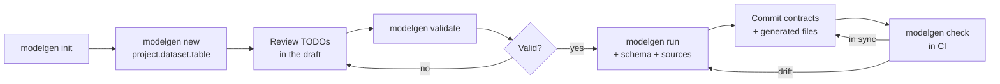

# 👻 Usage

## Lifecycle

Initialise once. Draft contracts from live tables. Generate. Let CI
prove nothing drifted.



```bash
modelgen init                                              # once per repo
modelgen new my-project.landing.user_signups               # draft a contract
modelgen validate contracts/user_signups.yml               # lint it
modelgen run                                               # raw + staging for every contract
modelgen schema contracts/marts.odcs.yaml -o models/marts  # models yml for tables this project produces
modelgen sources contracts/extract.odcs.yaml -o models/staging  # sources yml for tables this project reads
modelgen check --diff                                      # CI: prove nothing drifted
```

`run` does not write the schema or sources yml. Generate those with
`schema` and `sources`, commit the output, and let `check` gate it.

---

## Exit codes

| Code | Meaning |
|---|---|
| `0` | Success, or for `check`, everything in sync |
| `1` | A contract, config or generation error, drift, or a `--strict` failure |
| `2` | Usage error: bad or conflicting flags, or a contract path that does not exist |

---

## Commands

Every command takes `--help`.

### `modelgen init`

Scaffold a modelgen project: a documented `.modelgen.yml` plus
`contracts/` and `models/` directories. Refuses to touch a repo that
already has a `.modelgen.yml`.

```bash
modelgen init [DIRECTORY]
```

---

### `modelgen new`

Bootstrap a draft contract from a live BigQuery table. Requires GCP
Application Default Credentials.

```bash
modelgen new PROJECT.DATASET.TABLE [OPTIONS]
```

| Option | Description |
|---|---|
| `-n`, `--name` | Event name (default: derived from the table name) |
| `-o`, `--output PATH` | Directory for the contract (default: `./contracts`) |
| `--force` | Overwrite an existing contract file |

The draft is an ODCS v3.0.2 document. It declares **every** source column
as a schema property with introspected types and descriptions, guesses the
`primaryKey` (column names ending in `id`/`key`/`guid`/`uuid`) and
`modelgenLoadedAtField` (temporal columns named like
`received`/`loaded`/`created`/`*_at`), derives partition config from the
loaded-at column, and pre-wires `required: true` + `unique: true`
(→ `not_null`/`unique`) on the key. Guesses are flagged in the leading
`# TODO` comment. Review them before the contract goes live. `RECORD` and
`REPEATED` columns are declared without a cast (`physicalType` omitted).
Edit `apiVersion` if the contract should be newer than v3.0.2.

---

### `modelgen validate`

Offline validation: YAML structure first, then a full semantic lint.
No BigQuery credentials or network access needed.

```bash
modelgen validate contract.yml [--strict] [--server ID]
```

All findings are reported in one pass: typo'd incremental strategies,
casts to types the dialect does not know, duplicate columns, unsafe
identifiers, partition or cluster references to undeclared staging
columns, and keys the staging model never selects. See the
[lint rule catalogue](linting.md).

`--strict` turns warnings (missing descriptions, untested keys) into
failures. For CI gates with standards. A rule that is wrong for one
contract can be exempted with `modelgenExempt`; a reason is mandatory and
exempted findings still print.

---

### `modelgen gen`

Generate one layer from one contract. Give exactly one of `--raw`,
`--staging` or `--layer`.

```bash
modelgen gen CONTRACT [OPTIONS]
```

| Option | Description |
|---|---|
| `--raw` | Raw (Origin Data Product) layer |
| `--staging` | Staging (Consumption Data Product) layer |
| `--layer schema` | Models yml for produced tables. Same output as `modelgen schema` |
| `--layer sources` | Sources yml for extract contracts. Same output as `modelgen sources` |
| `-o`, `--output PATH` | Write files here (default: `./models`) |
| `--dry-run` | Preview without writing |
| `--from-contract` | Skip BigQuery introspection (see below). Ignored under `--layer` |
| `-t`, `--table NAME` | Generate only the named schema object. Repeatable. Default: every object |
| `-s`, `--server ID` | Pick the server by its `server:` id. Not accepted with `--layer sources` |
| `-v`, `--verbose` | Debug logging |

`--layer` takes exactly `schema` or `sources` and cannot be combined with
`--raw` or `--staging`. `gen` has no `--strict`; use `modelgen schema
--strict` or `modelgen sources --strict`.

Exit `2`: neither or both of `--raw`/`--staging` given, `--layer` combined
with them, an unknown `--layer` value, or `--server` with `--layer sources`.
Exit `1`: the contract is invalid (including an unknown `--table` or
`--server`), has lint errors, or generation or introspection failed.

```bash
modelgen gen contract.yml --raw     -o ./models/raw
modelgen gen contract.yml --staging -o ./models/staging
modelgen gen contract.yml --raw --dry-run
modelgen gen contract.yml --raw --from-contract
modelgen gen contracts/bus-marts.odcs.yaml --layer schema -o models/marts
```

---

### `modelgen schema`

Write one `_<contract-name>__models.yml` for tables the project produces.
Quality rules that map to dbt tests land under `tests/generated/` inside
the output directory (or `--tests-output`, below). A property-level
`rule: validValues` is not mapped here; it is reported as unmapped and
becomes `accepted_values` only in the staging yml.

```bash
modelgen schema contracts/bus-marts.odcs.yaml -o models/marts --strict
```

| Option | Description |
|---|---|
| `-o`, `--output DIR` | Output directory (default: `./models`) |
| `--tests-output DIR` | Put generated singular tests here instead of under `--output`, so the yml can live under `models/` while dbt finds the tests in `tests/` |
| `--dry-run` | Preview without writing |
| `-t`, `--table NAME` | Repeatable. Unknown names exit `1` |
| `-s`, `--server ID` | Pick the server by its `server:` id |
| `--strict` | Exit `1` when any quality rule cannot be mapped |
| `-v`, `--verbose` | Debug logging |

Unmapped rules are reported on stderr as `modelgen: N quality rule(s) not
mapped: <model>.<rule>`. With `--strict`, files are still written before
the exit `1`; with `--dry-run`, nothing is written but the exit `1` still
applies.

---

### `modelgen sources`

Write one `_<contract-name>__sources.yml` for tables the project reads
(extract contracts). See [Technical Reference](reference.md#sources-layer).

```bash
modelgen sources contracts/bus-positions-extract.odcs.yaml -o models/staging
```

Flags match `schema` (including `--tests-output`), except there is no
`--server`; passing it exits `2`.

---

### `modelgen run`

Find all event contracts and regenerate the raw and staging layers in one
command. It does **not** write schema or sources yml.

```bash
modelgen run [OPTIONS]
```

| Option | Description |
|---|---|
| `-c`, `--config PATH` | Path to `.modelgen.yml`. Auto-discovered upward from cwd if not given |
| `-s`, `--server ID` | Pick the server by its `server:` id |
| `--dry-run` | Preview without writing |
| `-v`, `--verbose` | Debug logging |
| `--from-contract` | Skip BigQuery introspection for all contracts (see below) |

Staging generation is skipped for contracts with no columns declared;
raw-only contracts are supported. Each source table is introspected
once per run, even when both layers use it.

---

### `modelgen check`

Drift detection. Renders every contract `.modelgen.yml` knows about in
memory and compares the output against the files on disk. **Nothing is
written.**

```bash
modelgen check [OPTIONS]
```

| Option | Description |
|---|---|
| `-c`, `--config PATH` | Path to `.modelgen.yml`. Auto-discovered if not given |
| `--diff` | Print a unified diff for every drifted file |
| `-s`, `--server ID` | Pick the server by its `server:` id. Sources contracts ignore it |
| `-v`, `--verbose` | Debug logging |
| `--from-contract` | Skip BigQuery introspection for all contracts |

`check` takes no contract path and no `--layer`, `--table` or `--strict`.
Besides the event contracts, it checks the schema and sources layers when
`schema_contracts`/`schema_output` and `sources_contracts`/`sources_output`
are set in `.modelgen.yml`.

Because generation is deterministic (same contract and source schema give
byte-identical output), `check` turns that guarantee into a CI gate.
Hand-edited models, stale regenerations, and contract changes that never
got committed all fail loudly:

```yaml
# Gitea Actions / GitHub Actions step
- name: Verify generated models match contracts
  run: |
    uv tool install wraith-modelgen
    modelgen check --diff --from-contract
```

Exit `0`: in sync, or no contracts matched and no `schema_contracts` or
`sources_contracts` pattern is set. Exit `1`: drift or missing files, a
contract that fails to parse, lint or introspect, a malformed
`.modelgen.yml`, or a `schema_contracts`/`sources_contracts` pattern that
matches no files.

---

## Configuration: `.modelgen.yml`

`run` and `check` read it; `gen`, `schema`, `sources` and `validate` never do.
Paths are relative to the file. Unknown keys are ignored silently.

```yaml
contracts: contracts/events/*.yml
raw_output: models/raw
staging_output: models/staging

schema_contracts: contracts/produced/*.odcs.yaml
schema_output: models/marts

sources_contracts: contracts/extract/*.odcs.yaml
sources_output: models/staging
tests_output: dbt/tests
```

| Key | Default | Read by |
|---|---|---|
| `contracts` | `contracts/*.yml` | `run`, `check` |
| `raw_output` | `models/raw` | `run`, `check` |
| `staging_output` | `models/staging` | `run`, `check` |
| `schema_contracts`, `schema_output` | unset | `check` |
| `sources_contracts`, `sources_output` | unset | `check` |
| `tests_output` | unset | `check` |

- Set each `*_contracts` key together with its `*_output`; a pattern without
  its output is not checked, and `check` does not say so.
- `tests_output` replaces the leading `tests` of generated singular-test
  paths. Pair it with `--tests-output` on `schema`/`sources`.
- The default `contracts` glob is `*.yml`. `*.odcs.yaml` files need their own
  glob, and extract (sources) contracts must stay out of the `contracts`
  glob, because event contracts require `modelgenLoadedAtField`.

---

## Offline / contract-only mode

By default, `gen`, `run`, and `check` introspect BigQuery at generation
time to validate column references and populate the raw schema YAML. If
no GCP Application Default Credentials are available, they fall back to
**contract-only mode** automatically, and no BigQuery connection is made.

Force it with `--from-contract`:

```bash
modelgen gen contract.yml --raw --from-contract
modelgen run --from-contract
modelgen check --from-contract
```

| Behaviour | With BQ | `--from-contract` |
|---|---|---|
| Column list in `raw_schema.yml` | Full source schema | Contract staging columns + key fields only |
| Schema drift detection | Yes, fails if staging refs a missing column | Skipped |
| New source column notices | Yes | Not reported (source not queried) |
| BQ credentials required | Yes | No |

Use the same mode that produced the committed files, or `check` will see
a different raw file. A DuckDB contract on a machine that has GCP
credentials still calls BigQuery unless you pass `--from-contract`.
`modelgen new` is the one command that always needs credentials.

---

## Contract file

A fully-annotated example: [`contracts/example_contract.yml`](https://git.thomaspeoples.com/thomaspeoples/wraith-modelgen/src/branch/main/contracts/example_contract.yml).

---

## Running the generated staging model

Staging defaults to a datestamped daily snapshot, partitioned on a
generated `ds` column. The daily run needs nothing:

```bash
dbt run --select stg__user_signed_up
```

Backfilling a past date uses the same SQL. Pass the date instead of
letting it default to dbt's run date. Dates are independent, so run as
many in parallel as your warehouse will take:

```bash
dbt run --select stg__user_signed_up --vars '{ds: 2026-07-27}'
```

Set `materialization: incremental` on `modelgenStaging` to opt back into a
high-water-mark load. See [Lint Rules](linting.md) for the checks that keep
the two modes from being half-declared. On DuckDB, models are views unless
the contract says `materialization: table`.

If the contract classifies any property, the generated model joins the
keystore, so the run needs a dbt source named `keystore.subject_keys` and
the reader needs `cloudkms.cryptoKeyVersions.useToDecrypt` on the KEK. See
[Keystore & Erasure](bigquery/keystore.md). Classification is BigQuery only.

---

## Upgrading from 0.14.1

The generated header changed: the first line of every generated file is now
`-- GENERATED by modelgen <version> from <name> <ver>. Do not edit.` (`#` in
yml), and the contract path is gone. The version is embedded, so **every
release that bumps it makes `check` drift on every committed file**. Plan a
regeneration in each upgrade PR:

```bash
modelgen run
modelgen schema contracts/bus-marts.odcs.yaml -o models/marts
modelgen sources contracts/extract.odcs.yaml -o models/staging
modelgen check --diff
```

`run` does not cover the schema and sources layers. Output generated from an
uninstalled source tree carries `modelgen 0.0.0` and will drift against a
released install; do not commit it. Generated quality tests call
`dbt_expectations.*` macros, so the consuming project needs that package
(or a replacement column-set test via `dbtColumnSetTest`).

---

## Schema evolution

Source schemas change. wraith-modelgen validates the boundary and reports what broke.

| Scenario | Behaviour |
|---|---|
| New column added to source | Does **not** appear until you regenerate. Run `modelgen run` (or `modelgen gen --raw`) to pick it up. Invisible in staging until added to the contract. |
| Source column renamed | Update the property's `physicalName` (the `primaryKey` property too, if applicable). The staging `name` stays stable downstream. |
| Source column retyped | Update staging `type:`. The `CAST` absorbs it. If values are incompatible, the warehouse will fail at query time. |
| Source column dropped | Generation fails if staging still references it. Update the contract or restore the source column. |

!!! tip "The layering principle"
    Raw absorbs source drift on each regeneration, with columns explicit and introspected at gen time. Staging absorbs raw drift. Downstream consumers see a stable interface.
